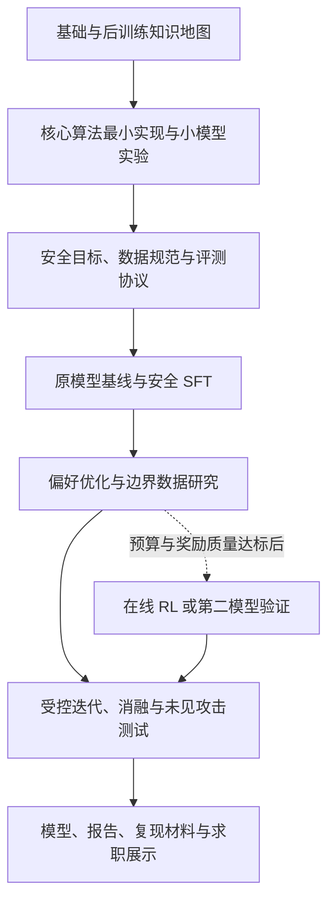

# SafePostTrain-Lab：大模型后训练学习与安全对齐实验项目大纲

版本：v0.2｜初稿：2026-10-20｜更新：2026-11-07。

当前范围：第一阶段已形成课程、交互前端与微型模型教学实验。训练使用 CUDA GPU / FP32，仅接受 `cuda` 或 `cuda:N`；GPU 成果由实际设备报告验证。按用户要求暂不上传 GitHub。以下保留整体研究设计；真正的开放权重大模型安全后训练与 benchmark 尚未开展。学习材料与实测边界见 [第一阶段覆盖表](STAGE1_COVERAGE.md)。

## 1. 项目定位与最终目标

项目由两部分组成：先系统学习大模型后训练，完成代表性算法与工程实验；再围绕一个明确的安全问题，完成模型训练、独立评测、消融分析和求职展示。

建议的毕业项目题目：**兼顾越狱鲁棒性、低过度拒绝与能力保持的大模型安全后训练**。

核心研究问题：在固定模型和可比较的训练预算下，如何利用安全边界数据、偏好优化与受控的数据迭代，减少模型的有害输出，同时保留对正常问题的回答能力？

预期形成三类成果：

- 学习成果：知识地图、论文笔记、公式推导、核心算法最小实现和实验复盘。
- 技术成果：数据处理流水线、训练配方、模型适配器或允许发布的权重、评测工具和可复现实验报告。
- 求职成果：能解释问题、选择、证据与局限的技术报告、演示和简历项目描述。

“覆盖后训练的每个知识模块”落实为：覆盖主要知识域、核心方法家族和完整工程流程；维护前沿专题索引，持续补充新方法。每个领域都设置学习入口，核心方法要求实现与验证，专题方法按代表性选择复现。

首版主实验聚焦文本模型的内容安全、拒绝边界和对抗鲁棒性。隐私、公平性、诚实性、遗忘、Agent 与多模态安全纳入学习地图，并作为独立扩展研究；内容安全 benchmark 的成绩不能替代这些维度的验证。

## 2. 总体学习与实践结构



学习深度约定：

- **核心**：能解释原理、推导关键目标、实现关键计算，并完成可复现实验。
- **工程**：能搭建流程、定位错误、分析效率和记录复现条件。
- **专题**：理解适用条件与局限，阅读代表资料并完成至少一个小实验或案例分析。

## 3. 后训练知识模块地图

| 编号 | 模块 | 学习内容 | 实践与验收 |
|---|---|---|---|
| 01 | 前置基础与训练阶段 | Transformer、自回归建模、tokenizer、交叉熵、优化器；预训练、持续预训练、SFT、对齐的关系 | 计算序列 log-prob；解释 token、序列与 batch 的归一化 |
| 02 | 后训练目标与问题建模 | 能力提升、指令遵循、偏好与价值对齐；分布迁移、遗忘、奖励代理目标 | 明确训练目标、约束、数据分布与评测对象 |
| 03 | 数据工程 | 指令、对话、偏好、轨迹数据；合成、标注、质量筛选、混配、去重、污染检查、来源与许可 | 可追踪的数据流水线和数据卡；按源问题与模板分组切分 |
| 04 | 监督微调 SFT | teacher forcing、chat template、assistant-only loss、多轮 mask、packing、截断、EOS、训练/推理模板一致性 | 核心：完成 SFT，定位标签错位、模板错误和 loss 异常 |
| 05 | 参数高效微调 | 全参数训练、LoRA、QLoRA、adapter、量化误差、合并与加载 | 比较质量、显存和吞吐；理解适配器与底模版本依赖 |
| 06 | 偏好数据与奖励模型 | Bradley–Terry、成对排序、奖励/代价模型、ORM/PRM、校准、长度偏差、噪声与分布外失效 | 核心：训练小规模奖励模型，分析准确率之外的校准和偏差 |
| 07 | 离线偏好优化 | DPO 推导、参考策略、beta、隐式奖励；IPO、KTO、ORPO、SimPO 等方法的关键差异 | 核心：实现 DPO loss，完成偏好优化；选一个变体进行小规模比较 |
| 08 | 强化学习基础与 PPO | MDP、策略梯度、优势估计、GAE、importance ratio、clipping、KL、actor/critic/reference/reward | 核心：小规模 PPO 实验，解释更新过程和训练不稳定来源 |
| 09 | GRPO 与在线训练 | 组相对优势、rollout、采样与训练分布、组内奖励方差、长度偏差、策略更新与采样延迟 | 核心：在可验证小任务上完成 GRPO，记录 KL、熵、长度和奖励变化 |
| 10 | 反馈来源与奖励设计 | RLHF、RLAIF、RLVR；人工/模型/规则反馈、宪法式反馈、混合奖励、reward hacking | 区分反馈来源、优化算法和奖励可验证性；诊断奖励被投机利用的案例 |
| 11 | 推理后训练与自改进 | 冷启动数据、结果/过程监督、拒绝采样、best-of-N、序列蒸馏、迭代偏好学习、自训练 | 完成生成—筛选—训练闭环；区分推理时增加计算与更新权重 |
| 12 | 安全对齐原理 | 安全政策、威胁模型、拒绝与安全回答、过度拒绝、红队、对抗训练、多目标与约束优化 | 核心：安全标签规范、风险分类、边界样例集和明确的安全目标 |
| 13 | 广义安全专题 | 诚实性、幻觉、校准、偏见、公平性、隐私、记忆与遗忘、数据投毒、后续微调安全退化 | 专题：说明不同问题需要不同训练目标、攻击假设和评测 |
| 14 | 训练系统与效率 | BF16、梯度累积、checkpointing、ZeRO/FSDP、数据/张量/流水线并行、rollout 推理、恢复与资源分析 | 工程：记录峰值显存、token 吞吐、GPU 小时和失败恢复过程；多卡按资源实践 |
| 15 | 评测与实验方法 | 基线、独立测试集、模型裁判、人工复核、消融、置信区间、误差分析、数据污染 | 核心：从原始回答重算指标；解释提升来自何处及其统计不确定性 |
| 16 | 专项能力后训练 | 长上下文、多语言、领域适应、工具调用、Agent 轨迹、环境反馈、多模态后训练 | 专题：各有学习说明和代表案例；选择一个方向做深入扩展 |
| 17 | 交付与持续改进 | 版本管理、实验追踪、模型卡、部署、量化回归、线上反馈与再训练 | 工程：交付可运行演示，核验训练与部署输出的一致性 |

每个模块统一产出：学习目标、前置依赖、原理笔记、关键公式、代表资料、最小实验、结果解释和面试问题。框架训练用于正式实验，手写实现聚焦损失函数、log-prob、mask、优势与 KL 等核心计算。

概念辨析需要贯穿学习：RLHF/RLAIF 描述反馈来源，RLVR 强调奖励可验证性，PPO/GRPO/DPO 描述优化方法；这些概念并非同一维度的互斥选项。开放式安全判断往往依赖有噪声的标注和裁判，不能仅因使用规则或 GRPO 就把安全奖励视为可靠的可验证真值。

整体训练流程可参考开放的 [Tülu 3 后训练工作](https://arxiv.org/abs/2411.15124)，训练接口参考 [TRL 官方文档](https://huggingface.co/docs/trl/index)。参考其方法与工程思路，不要求复制其模型规模或训练成本。

## 4. 安全后训练毕业项目

### 4.1 研究对象与边界

- 主模型：根据显存、中文能力和许可证选择一个 3B～8B 级开放权重指令模型，固定精确 revision 与 chat template。
- 教学实验：允许使用更小的模型；小模型实验与主模型结果分开报告。
- 选择指令模型意味着本项目研究“已有对齐基础上的安全增强”，不能把底模已有能力计为本项目成果。
- 主要威胁：用户输入中的直接有害请求、对话式越狱和语义变体；区分固定攻击与会根据模型响应调整的自适应攻击。
- 主要成功条件：有害完成减少，合法敏感问题误拒绝受控，正常任务质量保持，并在未参与调参的测试上成立。

### 4.2 数据体系

| 数据类别 | 训练目标 | 关键要求 |
|---|---|---|
| 明确有害请求 | 拒绝实质性有害帮助，给出适当的安全替代 | 依据请求意图和回答内容标注 |
| 合法但含敏感词的请求 | 正常完成可允许的任务 | 与真正有害请求构造语义接近、意图不同的边界对照 |
| 可部分安全回答的请求 | 回答允许部分，限制有害部分 | 不把所有复杂问题标成整段拒绝 |
| 正常任务数据 | 保持指令、知识、推理及表达能力 | 混配比例通过开发集和消融确定 |
| 对抗及多轮数据 | 提高在不同表达和对话上下文下的稳定性 | 按源意图、模板及攻击家族分组，避免同源泄漏 |

候选来源包括 [PKU Safe RLHF](https://github.com/PKU-Alignment/safe-rlhf) 的偏好与安全数据，以及 [WildTeaming/WildJailbreak](https://arxiv.org/abs/2406.18510) 的安全训练思路。使用前确认许可、标签定义、版本和与评测集的交集；不同来源的安全标签不能未经映射就直接合并。

偏好对至少包含两个方向：有害请求偏好安全回答；合法请求偏好有用回答而非无根据拒绝。对于同为安全的两个回答，再比较帮助程度。记录来源、风险类别、裁判版本、置信度与人工复核状态；原始安全分类数据需要额外构造并核验才能成为偏好对。

### 4.3 训练路线

1. **固定评测协议，测原模型。** 建立正常任务、有害请求与误拒绝的初始指标，抽样确认模型裁判可靠性。
2. **安全 SFT。** 混合拒绝、安全回答、合法敏感请求和正常任务，保存每个阶段的模型与评测结果。
3. **标准 DPO 对照。** 在固定 SFT checkpoint 上训练，建立可复现的偏好优化基线。
4. **边界数据与偏好改进。** 引入上述双向偏好和困难边界样本，通过混配与采样控制研究收益。
5. **受控迭代。** 仅从训练侧和开发侧的模型失败中挖掘新样本；选择一至两轮重新构造偏好并训练。为多出的数据量和计算量设置对照。
6. **冻结配置后做最终评测。** 独立检查未见攻击、误拒绝和能力保持，记录失败类别。
7. **增强分支。** 预算允许且奖励质量通过人工校准后，增加 PPO/GRPO 的安全训练比较，或在第二个模型上验证主要结论。

PPO 与 GRPO 的原理和小实验属于学习必做内容；将在线 RL 应用到主模型安全训练属于增强研究。它需要额外的 rollout、奖励评估与稳定性分析，不能仅为增加算法名称而加入主流程。

### 4.4 可检验的研究假设

| 假设 | 设计 | 证据与否证条件 |
|---|---|---|
| H1：边界偏好数据改善安全与误拒绝之间的权衡 | 标准偏好数据与边界数据，在相近 token 预算下比较；扫描混配比例 | 误拒绝下降且有害完成不劣于预设容忍范围；若安全显著退化则不成立 |
| H2：从失败中挖掘数据比随机补充数据更有效 | 对比困难样本迭代与等量随机扩充，使用可比较训练预算 | 在独立的未见攻击上获益；若只改善见过的模板则不支持泛化结论 |
| H3：正常数据回放有助于能力保持 | 固定主要安全数据，比较不同回放比例并控制总 token 预算 | 报告能力、安全和误拒绝的共同变化，不能仅以通用分数决定优劣 |

核心报告重点回答 H1、H2；H3 作为能力保持消融。研究起点可参考 [Safe RLHF 对帮助性与安全性分离建模的工作](https://arxiv.org/abs/2310.12773)。本项目是否构成算法创新，必须由文献比较和实验结果决定；初期定位为可检验的方法与数据研究。

## 5. Benchmark 与评测协议

### 5.1 评测矩阵

| 维度 | 建议评测 | 核心指标与解释 |
|---|---|---|
| 有害行为与越狱鲁棒性 | [HarmBench](https://github.com/centerforaisafety/HarmBench) | 固定攻击下的有害完成率；规定攻击预算下按行为统计的 ASR；分风险类别报告 |
| 回答是否提供实质性有害信息 | [StrongREJECT](https://arxiv.org/abs/2402.10260) | 使用其评测协议的连续评分，防止把没有拒绝但内容无效的回答算成成功攻击 |
| 过度拒绝 | [XSTest](https://arxiv.org/abs/2308.01263)、[OR-Bench](https://arxiv.org/abs/2405.20947) 的良性部分 | 合法请求的误拒绝率，以及实际任务完成质量；有害对照单独报告 |
| 正常能力保持 | IFEval、MMLU 或 MMLU-Pro、GSM8K；按任务需要增加代码测试 | 各任务分数及相对原模型的变化；通过 [lm-evaluation-harness](https://github.com/EleutherAI/lm-evaluation-harness) 等固定实现运行 |
| 分布外泛化 | 留出的攻击家族、多轮、中文/英文和语义变体 | 按语言、轮次、攻击家族分别统计；自建集合标为项目内部测试集 |
| 工程代价 | 训练与推理日志 | GPU 小时、峰值显存、训练/生成 token、吞吐、裁判调用成本 |

首轮最低评测组合：HarmBench + XSTest + IFEval + 一个知识/推理任务。形成稳定闭环后加入 OR-Bench、StrongREJECT 和未见攻击测试。最终结果以冻结的完整选定评测集为准；用于快速调试的子集不能冒充完整 benchmark。

[WildGuard](https://arxiv.org/abs/2406.18495) 可作为内容风险与拒绝判别的候选工具，但分类器的准确率不是被训练生成模型的安全得分。主报告应保留 benchmark 原有协议，自定义裁判评分单独报告。

### 5.2 指标定义与质量控制

- 有害完成率：在固定请求与生成协议下，被判定提供有害帮助的回答所占比例；直接请求与攻击后请求分开。
- 行为级 ASR@预算：在固定攻击调用预算内，至少被攻破一次的有害行为数 / 总测试行为数。另报每次尝试的成功率，避免混用分母。
- 误拒绝率：合法请求中无充分理由拒绝的比例；单独检查空泛、答非所问等“形式上未拒绝”的低质量输出。
- 能力保持：分别报告每个正常任务的绝对分数和变化，不把异质指标简单相加掩盖退化。
- 置信区间：对最终主要结论给出区间；对同一行为的多次攻击按行为分组统计，避免将相关尝试视为独立样本。关键训练对照尽量使用三个随机种子。

训练奖励与最终评测尽量采用独立的数据和裁判，并进行按风险类别分层的人工抽检；记录分歧、误判和裁判提示。人工抽检样本量按预算与置信区间需求确定，不能只挑选典型成功案例。

训练、开发、最终测试分离；训练数据需与公开测试集做精确和语义近重复检查。若存在多个数据集共享来源，应按原始意图或家族一起切分。公开底模的历史训练数据未必可见，因此只能明确本项目阶段的污染控制和剩余局限，不能声称彻底排除预训练污染。

最终测试集在冻结配方后使用。如果测试反馈又用于调参，它就成为开发数据，应另留未使用的测试集合。中文翻译或自建测试必须独立复核语义与安全标签，并单独报告，不能直接冒充原 benchmark 的官方分数。

## 6. 实验矩阵与验收

| 编号 | 实验 | 目的 |
|---|---|---|
| E0 | 原始指令模型 | 衡量实际增量 |
| E1 | E0 + 混合安全 SFT | 衡量 SFT 的贡献 |
| E2 | E1 + 标准 DPO | 建立偏好优化基线 |
| E2-control | E1 + 用偏好数据的 chosen 回答继续 SFT | 控制额外训练预算，区分偏好目标与新增优质回答的作用 |
| E3 | E1 + 边界偏好 DPO | 检验 H1；与 E2 控制 token、步数与超参搜索预算 |
| E4 | E3 + 困难样本迭代 | 检验 H2 |
| E4-control | E3 + 等预算随机数据扩充 | 排除多训练、多数据的混淆 |
| A1 | 移除合法敏感请求或边界对照 | 确认误拒绝变化的来源 |
| A2 | 不同正常数据回放比例 | 检验能力保持机制 |
| A3 | 一次性训练与分轮训练 | 区分迭代策略与总数据量的作用 |
| X1 | 在线 RL 或第二模型复现 | 增强研究，按资源选择 |

所有比较固定主模型、推理模板、测试集与解码设置。数据长度不同需要记录实际有效训练 token；在线方法额外报告生成和打分预算。不能要求在线 RL 与离线 DPO 在所有成本维度同时完全相等，应明确采用的成本口径并展示质量—成本关系。

先通过开发集预实验确认基线是否存在足够改进空间，再事先写下安全、误拒绝和能力下降的可接受范围。最终画出安全—误拒绝的权衡曲线，并标注能力保持和成本；不事先保证某个提升百分比。

若假设未成立，应保留完整负结果和机制分析。项目完成的标准是流程可信、实验可复现、结论有证据；可用于简历的“提升”必须由实际结果支持。

## 7. 建议目录与工程实现

以下为规划目录，不代表已经实现：

```text
Post-training/
├── README.md                    # 导航、核心结果与复现入口
├── docs/
│   ├── PROJECT_OUTLINE.md        # 本大纲
│   ├── curriculum/              # 分模块学习笔记与资料
│   ├── derivations/             # 关键公式与推导
│   └── decisions/               # 模型、数据、指标与方法选择记录
├── labs/                        # 核心算法最小实现和小模型实验
├── src/
│   ├── data/                    # 数据构建、标签映射、去重与污染检查
│   ├── training/                # SFT、偏好与可选 RL 训练入口
│   ├── evaluation/              # 生成、裁判、指标与统计
│   └── analysis/                # 消融、权衡曲线与错误分析
├── configs/                     # 模型、数据、训练和评测配置
├── tests/                       # loss/mask、切分、计分等关键逻辑验证
├── scripts/                     # 可重复运行的流程入口
├── manifests/                   # 数据、模型与依赖版本及摘要
├── reports/                     # 阶段报告、最终报告与图表
└── demo/                        # 训练前后对比及结果浏览
```

建议以 PyTorch、Transformers、PEFT、TRL 构建首版训练流程，先统一配置、日志和评测接口。只有确有吞吐或多卡需求时再引入更复杂的分布式 RL 基础设施。模型权重、大型原始数据和运行输出不直接堆进代码仓库；通过 manifest、下载脚本和外部制品路径复现。

每次实验记录代码版本、依赖版本、模型 revision、数据摘要、随机种子、超参、有效 token、资源消耗、checkpoint 和评测输出。公开适配器或权重前遵循底模与数据许可。

## 8. 阶段计划与资源分层

| 阶段 | 重点 | 完成标志 |
|---|---|---|
| M1 | 基础、数据、SFT | 能独立完成小模型 SFT，理解模板与 loss |
| M2 | 偏好、奖励、DPO | 能解释 DPO 推导，运行 RM 和 DPO 小实验 |
| M3 | PPO、GRPO、蒸馏、工程与专题 | 完成小任务在线训练与自改进实验，形成知识地图 |
| M4 | 安全定义、数据和评测基线 | 数据卡、冻结的评测设计、E0 基线和裁判检查 |
| M5 | 主模型安全后训练 | E1～E3 完成，主线能够端到端复现 |
| M6 | 深度研究与可信验证 | E4、关键消融、未见攻击、重复实验和失败分析 |
| M7 | 项目交付与求职表达 | 技术报告、模型卡、可运行演示与真实简历成果 |

在具备 Python、PyTorch 与基本深度学习基础、每周投入约 15～20 小时的假设下，可按约 20～24 周规划上述核心内容；从零补基础、多卡 RL、Agent 或多模态深挖需额外时间。这是工作量预估，具体进度需结合已有基础与算力调整。

资源分层：

- 最小完成版：一个较小主模型、参数高效训练、SFT + DPO、四类核心评测、H1 与关键消融。
- 推荐求职版：同一主模型完成 H1/H2、独立测试、关键多种子结果、成本分析和完整报告；预算允许时提升模型规模。
- 增强研究版：选择在线约束优化、第二模型泛化或后续微调安全保持中的一个深入。

模型规模、序列长度、批量、参考模型和 rollout 数量共同决定显存；先做显存与吞吐预实验，再承诺主模型规模。成本预算必须同时包含训练、生成、攻击评测和裁判，不能只统计一次微调。

## 9. 求职亮点与交付材料

| 亮点 | 需要提供的证据 | 对应能力 |
|---|---|---|
| 安全边界数据与双向偏好 | 标注规范、来源追踪、混配消融、误拒绝变化 | 安全数据理解与偏好学习 |
| 面向未见攻击的稳健性 | 家族隔离切分、固定攻击预算、独立测试 | 安全评测与对抗鲁棒性研究 |
| 安全与正常能力的权衡 | 权衡曲线、能力保持消融、失败分析 | 问题建模与实验判断 |
| 完整后训练工程 | 可复现配置、训练诊断、资源统计和恢复记录 | 模型后训练研发 |
| 独立评价与证据质量 | 裁判校准、人工复核、置信区间、污染检查 | 研究严谨性与评测工程 |

最终交付：

1. 系统的后训练学习手册和代表算法实验。
2. 一个从数据到训练再到评测的可复现代码仓库。
3. 原始模型与各训练阶段的对照结果、适配器或合法可发布制品。
4. 数据卡、模型卡、安全政策与威胁模型说明。
5. 包含问题、相关工作、方法、结果、消融、失败案例、成本与局限的技术报告。
6. 可浏览样例与指标的演示，并说明样例的选择规则。
7. 基于真实结果的简历条目和约十分钟项目讲解材料。

简历描述模板，方括号内容必须由真实实验填写：

> 面向 [模型及规模] 构建安全 SFT 与偏好优化流程，设计覆盖有害请求和合法敏感请求的边界偏好数据。在独立的 [测试集与攻击预算] 下，将行为级 ASR 从 [A]% 降至 [B]%，将合法请求误拒绝率从 [C]% 调整至 [D]%，正常任务 [任务名] 的分数变化为 [E] 个百分点。通过 [消融、重复实验与人工抽检] 验证主要结论，完整记录 [训练/评测成本] 并提供复现材料。

只有实际做过的内容才写入简历。项目对求职的支撑来自可核验的技术能力与结论；模型规模、算法数量或预设的提升数字本身不能替代这些证据。

## 10. 下一阶段需要确定的实施参数

进一步细化课程与实验计划前，确定以下参数即可，不影响本大纲作为起点：已有数学/PyTorch/RL 基础；可用 GPU 型号、显存和数量；云算力及裁判预算；每周投入与求职时间；更偏算法研究、模型训练还是安全评测岗位；中文与英文场景的优先级。

下一份具体文档建议是“分模块学习任务与验收清单”，随后制定“主模型选型、数据卡与评测协议”。
