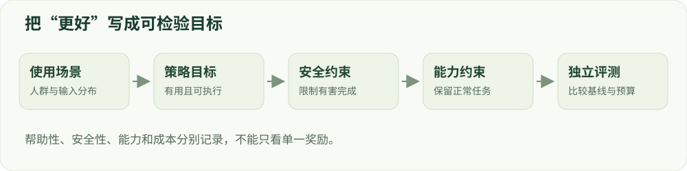

# 02 · 后训练目标与问题建模

目标、代理指标、约束与分布迁移。

建议学习时间：105 分钟（含阅读与练习，按个人基础调整）。

前置章节：01。

## 本章主要内容

- 帮助性、安全性、成本与任务分布
- 约束目标、代理奖励与 KL
- 分布迁移和灾难性遗忘
- 训练/开发/最终测试的职责
- 可否证假设、基线和预算

## 本章图解



目标建模：输入分布、目标、约束和独立评测。

## 学习目标

- 把模糊目标变成可测量问题
- 区分真实目标与代理奖励
- 设计训练、开发、测试之间的边界

## 一个分数无法描述所有目标

“模型更好”需要补全：对谁、在哪些任务、受哪些约束？客服助手要解决问题、遵守信息边界、保持事实可靠，训练成本也有限。若只优化拒绝率，最容易得到的策略可能是所有问题都拒绝。若只优化用户点赞，则可能奖励迎合和过度自信。

先写任务分布、允许的行为和失败代价。例如：在合法敏感问题上应正常解释，在明确有害请求上不提供实质性帮助；普通任务正确率的下降不能超过预先约定范围。这样的目标才能决定需要收集什么数据、如何比较方法。

## 把目标写成优化问题

设 πθ 是待训练模型，r(x,y) 是帮助性评分，c(x,y) 是安全代价。一个教学形式是最大化 E[r]，同时满足 E[c]≤δ。δ 是容许的平均代价上限。另一种做法是最大化 E[r−λc]；其中 λ 表达取舍，数值本身依赖评分量纲。

还可增加与参考模型的 KL 约束，限制行为漂移。KL 不是安全证明：一个原本不安全的参考模型，即使几乎不偏离也不会自动变安全。平均约束也不保证每个输入安全，必须检查风险类别、尾部失败和分布外行为。

## 奖励是尺子，不是目标本身

真实目标可能是“给出准确且安全的帮助”，而可计算奖励只是它的近似。若奖励模型偏爱长回答，模型可能学会冗长而非正确；若奖励只匹配拒绝词，模型可能先道歉再输出有害内容。优化越强，越可能发现评分器的漏洞，这就是奖励投机的重要来源。

处理方法是分解评分维度、人工抽检、引入独立评价，并观察长度、重复、拒绝等行为是否异常。不能因为训练 reward 上升就宣称能力提升。对评测裁判同样需要检查，它也是模型或规则，不是无误的真值。

## 用两个选项理解 KL

对于离散分布 p、q，KL(p||q)=Σᵢpᵢ log(pᵢ/qᵢ)，表示用 p 取样时两套概率解释的平均对数差。若 p=[0.8,0.2]、q=[0.5,0.5]，KL≈0.193 nats；交换 p 与 q 后数值一般不同。分布相同时 KL 为零，概率支持不兼容时可能发散。

训练中还要区分精确分布 KL 与采样估计。单条样本的 logπ−logπref 可以是负数，而精确 KL 的期望非负。看到一个负的采样值，先检查估计方式与样本量，不能直接断定数学公式错误。

## 训练分布与使用分布为什么会不同？

训练数据中的问题往往比真实问题短、干净、单轮。实际使用可能带有噪声、长上下文、不同语言或新的攻击方式。若只记住已见模板，随机切分同源改写仍可能给出虚高成绩。应按来源、原始意图或攻击家族切分，然后再生成改写。

开发集用于选择超参和排错；最终测试集只在方案冻结后用于判断。如果看过测试错误再改数据，那么这批测试事实上已经参与开发。还应记录模型版本、解码参数、评测提示和样本数，保证不同实验比较的是同一个问题。

## 动手：写一个可以被否证的假设

把“DPO 提高安全性”改写成：“在同一 SFT checkpoint 和相近 token 预算下，边界偏好 DPO 相比标准 DPO 能降低合法请求误拒绝，并在留出攻击家族上保持有害完成率不劣于容忍范围。”这句话明确了比较对象、预算、指标与泛化条件。

完成一页实验卡：目标、数据、基线、主要指标、次要指标、成本口径、失败标准。用安全实验器输入“所有问题都拒绝”的混淆矩阵，解释为什么一个看起来安全的模型仍然不可用。

## 技术重点：把假设写成反事实对照

例如“边界偏好是否降低合法请求误拒绝”，对照为同一起点的标准 DPO 和等预算 chosen-only SFT；预先限定有害完成率与普通任务下降可接受范围，再固定训练 token 和最终测试。

训练后若误拒绝下降但有害完成增加超过容忍范围，假设并未按原标准成立。数据量、超参搜索和评测采样预算都应记录，避免把更高成本造成的收益归因于方法。

## 研究连接：初始分布与探索

Demystifying RL Post-Training（2026，预印本）研究初始模型分布、奖励粒度和 prompt 分布如何影响 RL 结果，并强调目标行为原本有无概率质量会影响探索。它的受控结果启发我们记录起点和任务难度，不代表所有安全任务都可直接复用其结论。

实践：写一个以“边界数据改善合法请求完成质量”为目标的实验卡，明确 chosen-only SFT 对照、可容忍的有害完成率变化、样本分组和失败标准。冻结方案前把阈值写出来；不要根据测试结果事后选择评价口径。

## 算例：多目标约束

模型 A 的有害完成为 8/100、合法敏感请求误拒绝为 30/100；模型 B 分别为 10/100 和 12/100。如果事先要求有害完成不高于 9%，仅凭误拒绝降低不能宣布 B 达标；若抽样较小，还要比较不确定区间而非把每个观测比例当真值。

约束只是示例，真实阈值需要与业务风险及样本量共同确定。也要检查正常任务的质量，防止模型既不直接拒绝、又只给出无帮助的空话。

## 检查清单：一张实验卡

填写目标用户与场景、数据/语言、模型版本、主指标与约束、基线、训练与生成预算、调参范围、独立裁判和终止条件。将“看见什么结果能推翻假设”写在运行前，避免只选择支持结论的指标。

## 实现细节：平均约束与尾部风险

以安全代价 c 为例，E[c]≤δ 是平均约束；即使平均值达标，某个语言或风险类别仍可能失败。应同步检查条件指标 E[c|类别]、最差分组及样本数。拉格朗日形式 r−λc 只是把约束引入目标的方式，λ 的数值随奖励尺度变化。

如果使用自适应 λ，更新方向、步长和代价估计器需要明确；训练批次上满足约束不代表未知输入也满足。将约束阈值、类别权重和模型选择规则写进实验卡，防止结果出来后再更换标准。

## 实现细节：避免比较中的混淆因素

除起点和 token 预算外，还需固定数据来源、解码、评测裁判、搜索范围与模型选择规则。方法 A 多做了几轮样本筛选时，应记录教师生成与裁判成本，并设置等额随机扩充；否则收益可能来自更多数据或调参，而不是算法本身。

## 案例实操：把安全目标写成有对照的实验卡

输入：设定一组合法敏感请求和一组有害请求，以及可用训练 token 和评测次数。步骤：写出原模型、标准 DPO 和边界 DPO；指定误拒绝率、有害完成率与普通任务质量，并在运行前给出不能接受的退化范围。

交付：一页实验卡和分组评测表，列出假设、数据来源、对照、预算、指标、裁判与停止条件。如果只改善合法请求却超过预定有害完成约束，就不能按原条件宣布假设成立。这里是研究设计，不是已完成的实验。

## 代码与数据片段

局部片段：把实验假设写成配置。以下是局部教学片段，运行前需结合上下文准备变量。

```python
experiment = {
    "start_checkpoint": "sft-revision",
    "comparison": ["chosen_sft", "standard_dpo", "boundary_dpo"],
    "primary_metric": "benign_over_refusal_rate",
    "constraints": ["harmful_completion", "general_capability"],
    "held_out_group": "unseen_attack_families",
}
```

## 论文精读问题

- [Tülu 3 开放后训练流程](https://arxiv.org/abs/2411.15124)：公开配方怎样连接数据、方法和评价？
- [Demystifying RL Post-Training（2026，预印本）](https://arxiv.org/abs/2608.24949)：初始分布和奖励设计为何影响在线优化？

## 常见误区

先选一个热门算法，再寻找支持它的指标。应先固定问题、对照和评价口径，再选择方法。

## 检查理解

1. 训练奖励持续上升，能直接说明什么？

   - A. 模型全面变好
   - B. 当前优化目标的评分提高
   - C. 未见攻击必然更难成功

   答案：B。奖励只是代理指标，真实能力和安全性需要独立评测。

2. 用最终测试集的失败案例反复调整训练数据后，这个测试集应视为？

   - A. 仍是独立测试集
   - B. 开发数据的一部分
   - C. 无标签训练集

   答案：B。模型选择已受该集合影响，需要另留未使用的测试集合来支持独立结论。

## 一手资料

- [Safe RLHF](https://arxiv.org/abs/2310.12773)
- [Tülu 3 开放后训练流程](https://arxiv.org/abs/2411.15124)
- [Demystifying RL Post-Training（2026，预印本）](https://arxiv.org/abs/2608.24949)

本章正文的数值例子用于教学；真实微型模型的实测结果另见实战报告。
