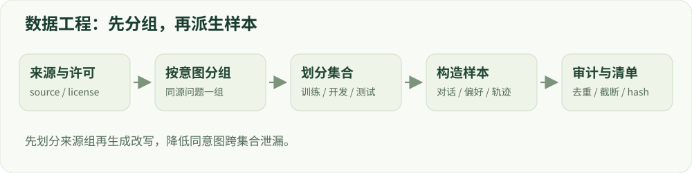

# 03 · 数据工程

数据格式、标注、混配和防泄漏。

建议学习时间：115 分钟（含阅读与练习，按个人基础调整）。

前置章节：01、02。

## 本章主要内容

- 指令、对话、偏好及轨迹格式
- 合成数据、标注规则与质量审查
- 采样、混配和有效 token
- 按来源/意图分组、去重与污染控制
- 数据卡、许可和完整追溯

## 本章图解



数据处理流程：追溯来源、分组切分、格式化与审计。

## 学习目标

- 区分指令、偏好与轨迹数据
- 建立可追溯的清洗和切分流程
- 理解去重、污染检查与数据混配

## 三种数据回答三个问题

SFT 数据描述“应该怎样回答”，常见格式为 messages，包含 role 与 content。偏好数据描述“同一问题下哪个回答更好”，常见字段是 prompt、chosen、rejected。轨迹数据描述“模型在环境中做了什么”，还需保存动作、观察、奖励、结束状态以及策略版本。

一条安全/不安全分类标签并不自动变成偏好对。要构建偏好对，必须给同一个上下文配上两个可比较回答，并明确偏好原因。若 chosen 既更安全又更长，模型可能学习到长度捷径，因此需要控制混杂因素。

## 从来源到可训练样本

建议流水线：登记来源与许可 → 校验结构 → 过滤空值和损坏文本 → 去重 → 分组切分 → 质量标注 → 混配 → 导出版本。每条记录保留 source_id、原始问题簇、语言、风险类别和标注版本，便于出现问题时追溯。

格式有效不代表内容正确。人工抽样应检查角色顺序、答案是否被截断、标签是否与政策一致。合成数据需要说明教师模型与生成设置；模型评分存在系统性偏差，低置信度或裁判分歧样本应进入人工复核。个人敏感信息应在进入训练前按明确规则处理。

## 切分要发生在改写扩增之前

假设一个原始问题生成 20 个近义改写。如果先改写再随机分到训练和测试，模型可能在训练中见过几乎一样的意图。先把原始问题簇分组划入不同集合，再做各自的扩增，能够控制这类泄漏。

精确去重可用规范化文本的哈希；近重复可用 n-gram、MinHash 或语义向量检索，再人工确认候选。语义相似不必然等于重复：合法安全教育与危险操作可能词汇相近、标签相反。污染检查需要记录判定规则和人工审查结果。

## 混配改变模型看到的世界

假设安全数据占 80%，普通数据占 20%。模型会频繁接受安全相关梯度，但有效权重还受样本长度、重复采样、loss 归一化影响。因此既要报告样本比例，也要报告有效训练 token 比例。

不同质量、来源、语言的数据可以分层采样。困难样本能帮助边界学习，过量使用也可能造成噪声放大。每轮只改一个关键因素，并用固定开发集看收益。用“同等数据量”和“同等 token 预算”分别比较时，必须说明采用哪一种口径。

## 动手：做一次数据审计

创建六条教学样本：正常请求、合法敏感请求、明确不允许请求各两条。为每条写来源、意图、期望行为、标签理由；只用无害的抽象请求，不需要收集危险操作细节。再人为制造一条重复和一条角色顺序错误，检查流程是否能发现。

交付一张数据卡：规模、语言、来源、许可、切分方法、风险分类、清洗数量、标注一致性和已知局限。把失败样本保留在审计记录中，不能只保留漂亮的统计。

## 技术重点：区分 SFT、偏好与轨迹数据

SFT 样本通常含对话消息或 prompt/completion；偏好样本含同一 prompt 的 chosen/rejected；Agent 轨迹还需保存工具 schema、调用、返回、权限和最终结果。数据单元不同，直接把字段重命名不等于形成正确监督。

每条数据至少有稳定 ID、来源、license、任务类别与 group_id；偏好还要有标注方向、评分依据和冲突状态。训练前检查角色顺序、空值、格式、重复项、允许行为、EOS、长度与截断。

## 技术重点：切分、去重和污染防护

先按原始问题、攻击家族或意图聚类，再将组分配到训练、开发、最终测试；派生改写继承原组。精确 hash 检测字面重复，语义近重复检索需要人工校准阈值；对于公开测试，也要检查后训练新数据是否存在同源条目。

底模预训练语料通常不可完全观察，因此能控制的是本项目可见数据，不能宣称彻底排除所有预训练污染。记录无法审计的来源、版本和可能重叠。

## 技术重点：配比不仅是行数

同类样本回答长度不同，按行采样会产生不同的监督 token 权重；多轮样本、截断和 repetition 也会改变有效分布。比较配方时记录各来源抽样概率、样本数、有效 token 和实际 optimizer steps。

制作数据卡：来源与许可、标注说明、类别/长度分布、样本选择、分组策略、去重/污染审计、版本哈希、复核分歧和用途边界。

## 三种数据契约与字段检查

SFT 对话样本可用 messages 数组：每条消息至少有 role 和 content；偏好样本需要同一 prompt 及 chosen/rejected 两个完整回答；在线 RL 样本至少有 prompt、验证目标和元信息，rollout 后另存生成、策略版本与奖励。字段格式应以实际 trainer 版本文档为准。

建立转换器时逐行验证角色顺序、空内容、非法字符、answer 是否属于对应 prompt、结束标记及 token 长度。按 data_source、license、原问题 group_id、风险标签、标注人或裁判版本生成清单；让任何训练样本都能追溯到数据版本。

## 算例：一条数据从原始记录到训练

原始记录含 source_id=Q42、风险标签、许可、两条回答和审查状态；先将 Q42 分到训练组，再生成若干改写，保留 parent_id=Q42。转换成 SFT 时使用 chosen 作为目标；转换 DPO 时保留同一个 prompt 的两个完整回答。开发或最终组不得出现 Q42 的改写。

记录格式校验失败、重复、过长截断、人工复核分歧及训练采样权重。输出 data_manifest.json、按组切分清单和文件哈希；可复算输入的样本数及有效 token，不能只保存一份去重后的最终文件。

## 排查标签与数据污染

随机检查每类样本的来源与标签；对偏好数据交换 chosen/rejected 后运行小样本检查评分方向。对评测集先做精确/归一化匹配，再人工复核语义近重复；未知底模预训练语料需要单列为未能完整审计的范围。

## 实现细节：从行级 JSON 到可训练样本

SFT 可表示为 prompt/completion，或按顺序存储 role/content 消息；偏好数据将同一 prompt 与 chosen/rejected 分开。转换时不仅检查字段是否存在，还要检查 chosen/rejected 都是对该 prompt 的回应、角色一致、结尾符合模板，并拒绝空监督。

工具轨迹的 tool 结果是环境观察，不一定是模型输出目标。若错误地把工具返回当作助手标签，模型会被训练去虚构环境结果；应按角色和任务定义标签，并核实来源和授权。

## 实现细节：分组抽样与来源追溯

一个原问题可能被人工或模型改写多次，因此应让每条派生样本继承 source_id 和 intent_group。先分配 group 到训练/开发/测试，再生成变体；如果先增广后逐条随机切分，表面不同的文本仍可能泄漏同一任务。

混配报告至少包含来源比例、抽中次数、各来源监督 token、平均长度与截断比例。仅说“安全数据占 30%”不足以知道它指样本、token 还是采样概率。

## 案例实操：从源问题构造数据分组

输入：给一个原问题 Q42 和若干同义改写分配相同 group_id；另准备其他来源的问题组。步骤：按 group_id 切分训练、开发和最终测试，再分别生成需要的消息与偏好对；运行 labs/data_audit.py 观察结构检查和精确去重。

交付：保留 source_id、group_id、许可、分配集合及哈希的清单，统计每类样本数、有效 token 与截断数。脚本示例的精确去重不能代替语义去重或证明预训练阶段无污染。

## 代码与数据片段

局部片段：验证组不跨切分。以下是局部教学片段，运行前需结合上下文准备变量。

```python
# train_groups / dev_groups / test_groups 是源问题或意图 ID 集合
assert train_groups.isdisjoint(dev_groups)
assert train_groups.isdisjoint(test_groups)
assert dev_groups.isdisjoint(test_groups)
# 改写样本继承相同 group_id；应先分组，再生成改写。
```

## 论文精读问题

- [TRL · Dataset Formats](https://huggingface.co/docs/trl/dataset_formats)：不同 trainer 支持的数据字段和消息结构是什么？
- [Datasheets for Datasets](https://arxiv.org/abs/1803.09010)：数据来源、用途与已知限制如何记录？

## 常见误区

把所有含敏感词的样本都标为有害，会让模型学会关键词触发式拒绝。要结合意图、上下文和回答内容。

## GPU 微型模型实战

在 [实战指南](../../labs/tiny_lm/README.md) 中把本章公式连接到 CUDA 上的真实 token 训练、日志与生成。微型合成任务不代表大模型安全 benchmark。

## 检查理解

1. 同一个原始问题有 20 个改写，应怎样分配？

   - A. 把全部改写随机拆开
   - B. 按原始问题簇分组后切分
   - C. 只按文本长度排序切分

   答案：B。分组切分避免同源近义改写同时出现在训练和测试。

2. 50% 的样本来自安全数据，是否代表 50% 的有效 token 来自安全数据？

   - A. 是，比例相同
   - B. 不一定，还取决于长度与 mask
   - C. 只有 DPO 才不同

   答案：B。样本长短、被 mask 的 token 和采样次数都会影响有效训练占比。

## 一手资料

- [TRL · SFT Trainer](https://huggingface.co/docs/trl/sft_trainer)
- [TRL · DPO Trainer](https://huggingface.co/docs/trl/dpo_trainer)
- [Tülu 3 开放后训练流程](https://arxiv.org/abs/2411.15124)
- [TRL · Dataset Formats](https://huggingface.co/docs/trl/dataset_formats)
- [Datasheets for Datasets](https://arxiv.org/abs/1803.09010)

本章正文的数值例子用于教学；真实微型模型的实测结果另见实战报告。
