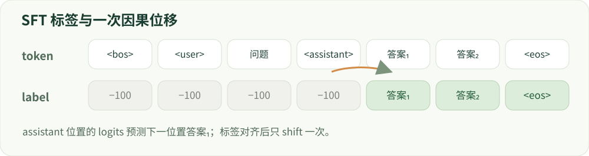

# 04 · 监督微调 SFT

从对话模板到第一个可靠的 loss。

建议学习时间：120 分钟（含阅读与练习，按个人基础调整）。

前置章节：01、03。

## 本章主要内容

- teacher forcing 与 token 级交叉熵
- chat template、角色边界及 EOS
- assistant-only loss 与多轮标签
- shift、截断、padding 和 packing
- 训练/推理模板一致性与排错

## 本章图解



同一序列中，用户与角色位置不监督；助手回答及 EOS 参与监督。

## 学习目标

- 计算带 mask 的 token 交叉熵
- 理解 teacher forcing 和因果位移
- 诊断模板、packing、EOS 与截断问题

## SFT 不是把答案存进数据库

监督微调拿一对上下文 x 和理想回答 y，通过梯度更新，让模型在这个上下文下更倾向于生成 y。训练通常用 teacher forcing：预测下一 token 时，前文使用真实答案的前缀，而不是模型刚生成的错误前缀。推理时只能看到自己生成的前缀，因此训练 loss 低并不保证长回答不跑偏。

SFT 适合教授任务格式、风格和行为示范。数据质量比“形式上是问答对”更重要。如果理想回答包含错误事实或过度拒绝，模型也会学习这些模式。训练和验证都要检查真实生成，而不只看损失曲线。

## 公式中的每一项是什么？

令 mₜ∈{0,1} 表示这个 token 是否参与监督，pₜ 是正确下一 token 的预测概率。L = −Σₜmₜ log pₜ / Σₜmₜ。这里用有效 token 平均；若先对每个样本平均再对 batch 平均，短样本会获得不同权重。所有 mₜ 为零时不能直接除零，应拒绝该样本或显式跳过。

例子：用户部分两个 token 被 mask；助手部分两个正确 token 的概率分别为 0.5、0.25。loss = (0.693 + 1.386)/2 ≈ 1.040。把用户部分也纳入 loss 会改变训练任务，即使它们仍作为上下文供模型注意到。loss mask 和 attention mask 是两件事。

## 对话模板与标签位移

聊天模型常用专门的角色起止标记组织 system、user、assistant。必须使用与底模匹配的 tokenizer 和模板。训练时不要额外重复 BOS/EOS；推理时需要正确地提示“现在轮到 assistant 回答”。模板不一致会导致模型学到错误的角色转换。

自回归标签需要一位位移：位置 t 的 logits 对应位置 t+1 的 token。很多 causal-LM 实现内部处理 shift，外部又 shift 一次会错位。assistant-only loss 要根据真正的 token 边界生成 mask，不能仅按字符串字符长度切分。多轮对话还需要明确训练所有助手轮次，还是仅最后一轮。

## packing、长度与训练稳定性

packing 把多个短样本放进一个序列以减少 padding，但必须定义样本边界与注意力隔离方式。EOS 能标示结束，普通因果注意力下它本身不一定阻止后一个样本看到前一个样本。应检查框架是否启用分段注意力或等价隔离机制。

截断可能切掉答案甚至让有效监督 token 为零。先看长度分布，再定最大长度；记录被截断比例。训练先用少量高质量样本检查能否过拟合，再扩大数据。若 loss 为 NaN，检查空 mask、数值精度和梯度；若 loss 正常但模型乱码，检查模板、保存和加载是否一致。

## 动手：先算对，再训练

在下方点选 token 是否计入 loss，预测分母变化，再验证结果。运行 labs/core_math.py 查看相同计算。进一步训练小模型时，先打印一条样本的 token、角色、label 与 mask，再启动一轮最小更新。

学习验收：给出 loss 下降但验证回答变差的两种解释，并提出检查方法。建议包括过拟合、标签错误、训练/推理模板不一致，而不是只调整学习率。

## 技术重点：对话模板、多轮和截断

训练完整消息时不应在已结束的回答后多加一个空 assistant 标记；推理的 prompt 需要按模型模板生成正确的助手前缀。对 prompt/completion 分开提供的框架，要检查其拼接后的前缀与推理相同。

多轮数据需说明监督所有助手轮还是只监督最后一轮。截断可能剪掉答案、EOS 或用户语义；若有效标签全为 −100，应明确拒绝样本或报错，不能把空 loss 当训练成功。

## 技术重点：packing 与 mask 的工程验证

packing 可以减少 padding，但有的实现把多个样本拼成连续流，有的提供样本隔离注意力。不要假定所有框架都会隔离；实际更改前一条样本并观察后一条 logits 是否变化。记录 position IDs、attention mask 和样本边界策略。

比较训练预算时，同时统计总 token 与助手监督 token；梯度累积只改变更新频率，多个不同长度 micro batch 的平均方式可能改变梯度权重。

## 排错顺序与小实验

若 loss 一开始异常低，先检查是否全是 -100、目标是否被提前复制到上下文或错把 pad 当 EOS；若 loss 看似正常但生成立刻结束，检查 EOS 标签、终止设置、模板与截断。梯度非零并不证明标签对应正确回答。

练习：同一条四轮消息分别构造完整序列 loss 和 assistant-only loss，在同一模型、同一输入上打印有效位置和梯度；再变动用户文本，解释无监督 token 仍通过注意力影响助手预测。显式检查角色分隔符及模型要求的结束符。

## 算例：一个 batch 的监督位置

两条样本长度分别为 8 和 5，padding 到 8；其中助手监督 token 数为 3 和 2。按有效 token 平均的 NLL 分母为 5，而不是 batch×序列长度=16。padding 位置、用户内容和角色提示不计入监督，但用户内容仍影响上下文。

若把一条样本的监督全部截断，不能用零损失继续训练。打印 tokens、labels 和 attention mask，确认 EOS 在合理位置；多轮对话要决定只监督最后一轮还是监督所有助手轮，并与训练配置一致。

## 验证实验：模板对齐

对同一条对话分别打印训练样本的 prompt 前缀和推理时 generation prompt 的 token ID，检查前缀是否一致，再打印监督答案。记录 tokenizer revision 和 chat_template 摘要；模板更改后重新检查，而不是只比较解码文本外观。

## 实现细节：多轮监督掩码

假设消息顺序是 user₁、assistant₁、user₂、assistant₂。若目标是监督所有助手轮，两个 assistant 的内容及其需要学习的结束标记参与 loss；若只训练最后一轮，则第一轮助手回答也作为上下文屏蔽。具体标记边界必须来自 tokenizer 和选定任务。

构造 labels 后先检查每个非忽略位置是否与 input_ids 对应；随后只进行一次时序位移。实际框架可能在模型内部计算 shift，额外手动 shift 会把目标错位。

## 实现细节：截断、padding 和 packing

截断可能保留 prompt 却删掉整个答案，或保留答案却失去任务条件；应记录原始/保留长度并拒绝无监督样本。padding 标签一般使用 ignore_index，attention mask 控制无效键值，两者都要验证。

把样本拼接进入同一序列后，若实现没有隔离注意力，后一个样本可能读到前一个样本。通过改变前一条样本并比较后一条的 logits，可检查隔离假设；不要把 packing 一律等同于样本独立。

## 案例实操：核查真实 Qwen3 的 labels

输入：查看 reports/real_model/sft.json 中的 mask_check 和 labs/real_model/run.py 的 inspect_sft_mask。步骤：对照一条 prompt/completion 的 token 和 trainer collator 的 labels，找出用户内容被屏蔽的位置、答案首 token 与 EOS。

交付：一张 token/label/mask 对照表，并说明模型还是框架负责 shift。项目记录中 8 条合成训练样本通过了该检查；2 步 SFT 只验证流程，不能推断模型安全性。

## 代码与数据片段

局部片段：手动计算一次移位的 SFT loss。以下是局部教学片段，运行前需结合上下文准备变量。

```python
import torch.nn.functional as F
# logits: [B, T, V]；labels: [B, T]，不监督位置为 -100
shift_logits = logits[:, :-1, :].contiguous()
shift_labels = labels[:, 1:].contiguous()
loss = F.cross_entropy(shift_logits.reshape(-1, shift_logits.size(-1)),
                       shift_labels.reshape(-1), ignore_index=-100)
# 若所用模型/Trainer 已内部 shift，不要再做第二次。
```

## 论文精读问题

- [TRL · SFT Trainer](https://huggingface.co/docs/trl/sft_trainer)：该版本的数据格式与 completion/assistant mask 如何工作？
- [Transformers · Chat templates](https://huggingface.co/docs/transformers/chat_templating)：训练模板与生成模板分别何时追加助手前缀？

## 常见误区

mask 掉用户的 loss，不代表模型看不到用户输入。模型仍需读取用户上下文，才能预测助手回答。

## GPU 微型模型实战

在 [实战指南](../../labs/tiny_lm/README.md) 中把本章公式连接到 CUDA 上的真实 token 训练、日志与生成。微型合成任务不代表大模型安全 benchmark。

## 检查理解

1. 只有两个有效 token，正确概率分别为 0.5 和 0.25，平均 NLL 约为？

   - A. 0.375
   - B. 1.040
   - C. 2.079

   答案：B。−(ln 0.5 + ln 0.25)/2≈1.040；2.079 是总和，不是平均值。

2. assistant-only loss 中，用户 token 通常怎样处理？

   - A. 既不可见也不计算 loss
   - B. 仍作为上下文，但不计算它们的监督 loss
   - C. 变成随机 token

   答案：B。loss mask 控制监督位置，attention mask 控制注意力可见性。

## 一手资料

- [TRL · SFT Trainer](https://huggingface.co/docs/trl/sft_trainer)
- [Transformers · Chat templates](https://huggingface.co/docs/transformers/chat_templating)

本章正文的数值例子用于教学；真实微型模型的实测结果另见实战报告。
