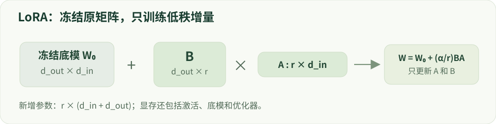

# 05 · 参数高效微调

把参数、显存和表达能力分开理解。

建议学习时间：110 分钟（含阅读与练习，按个人基础调整）。

前置章节：04。

## 本章主要内容

- 全参数、冻结层与 adapter 的取舍
- LoRA 低秩矩阵、rank 与目标模块
- QLoRA、量化与计算精度
- 可训练参数、显存及吞吐
- 适配器保存、加载、合并与回归

## 本章图解



矩阵形状、低秩增量和新增参数的计算。

## 学习目标

- 计算低秩适配器的参数量
- 区分可训练参数与总显存
- 解释量化、合并与部署一致性

## 把一大块更新拆成两小块

全参数微调允许修改每个权重。LoRA 冻结原权重 W，用两个较小矩阵 B、A 表示更新：W′=W+(α/r)BA。若 W 的形状是 d_out×d_in，B 是 d_out×r，A 是 r×d_in。r 是秩，决定这条更新通道的容量。

可训练参数从 d_out×d_in 变为 r(d_out+d_in)。例如 4096×4096 的投影层有 16,777,216 个权重；r=8 的 LoRA 有 65,536 个参数，约为 0.39%。这是一个投影层的计算，不是整个模型的比例。目标模块选哪些层，会显著改变总参数量。

## 为什么少参数也可以改变模型？

已有模型学到了大量通用表示，适应一个任务可能只需沿少数方向调整。低秩更新提供了这种约束，但“少数方向足够”是任务相关的经验，不是所有后训练任务的保证。r 太小可能欠拟合；增加 r 也不保证更好，还会增加优化和保存成本。

常见初始化会让 BA 初始为零，因此起步时等价于原模型。α/r 是原始 LoRA 的常见缩放，其他变体可能使用不同缩放。比较 rank 时要同时记录 alpha、dropout、目标模块、学习率和数据预算，否则不能把效果全归因于 rank。

## QLoRA 量化的是哪一部分？

QLoRA 把冻结底模以低比特形式存储，计算时按需要反量化，同时训练低秩适配器。它不是把所有训练计算都变成四位整数。适配器、梯度、优化器状态和激活仍然需要存储，具体精度由实现和配置决定。

因此“7B 模型四位约 3.5GB”只是理想的权重数据量，不是训练总显存。量化尺度等元数据、激活、临时张量和加载开销都会增加占用。在线 RL 还可能需要参考模型、奖励模型与 rollout 缓存，不能只拿底模权重大小推断能否训练。

## 从训练适配器到可部署模型

保存适配器时记录底模精确版本、tokenizer、目标模块与缩放参数。加载到另一个同名但不同 revision 的底模上，结果不一定一致。合并通常把 BA 加回底模权重，但在量化底模上涉及反量化与重新量化，应对合并前后输出做回归检查。

还要检查是否训练了 embedding 或输出头，它们可能需要额外保存。比较 LoRA 与全参数训练时，应报告训练 token、显存、吞吐、能力及安全指标，避免只展示参数节省比例。

## 动手：算一算适配器成本

在参数实验中改变输入/输出维度和 rank，先预测参数量是否线性变化，再观察实际数值。给一个模型的目标层列表，逐层相加，而不是将单层比例直接套到整个模型。

面试练习：为什么冻结底模仍然需要反向传播穿过它？因为需要算适配器参数对 loss 的影响；冻结的是不更新的参数，不代表所有中间激活都能消失。

## 技术重点：从全参到 LoRA

全参数训练需要为所有参与更新的权重维护梯度及优化器状态；LoRA 冻结原矩阵 W₀，训练低秩增量 ΔW=(α/r)BA。A 的形状为 r×d_in，B 为 d_out×r；新增参数数目是 r(d_in+d_out)。常见初始化令增量起始为零，但需查看具体配置。

对 4096×4096 的矩阵，r=8 时新增 65,536 参数，而原矩阵有 16,777,216。此数值只适用一个矩阵；真实模型需按目标模块与层数累计，embedding、bias 和其他可训练层需单列。

## 技术重点：QLoRA 与总显存

QLoRA 通常把冻结底模以低位量化存储，同时对 adapter 执行高精度计算和更新。4-bit 参数并不意味着整个训练只占全参 BF16 的四分之一：激活、adapter、优化器、非量化层、缓存与 kernel 临时空间都存在。

先确认量化库、设备和版本支持，再分别记录 quant type、compute dtype、双重量化、目标模块与实际显存。长序列的激活可能是瓶颈；对比需固定长度、micro batch、累积和生成设置。

## 技术重点：适配器生命周期

保存 adapter 时保留底模 ID/revision、target_modules、rank、alpha、tokenizer 和模板。加载后核查 trainable 参数、梯度、实际 target 命中；合并或量化后以固定输入比较输出，并重新跑关键安全/能力测试。

常见失败包括模块名不匹配导致没有可训练参数、误绑定不同底模、SFT 和 DPO 使用不一致的 adapter、将 adapter 文件误称完整权重。

## 排查 adapter 不起作用

依次查看目标模块是否匹配、可训练参数是否大于零、反向传播后 adapter 梯度是否有效、optimizer 是否包含这些参数；最后对比训练前后参数哈希。加载时核对底模 revision、adapter 配置和 tokenizer，合并后执行固定输入回归。

## 实现细节：LoRA 的第一步梯度

对 ΔW=BA，若 A 随机初始化、B 初始化为零，则初始 ΔW=0。第一步中 ∂L/∂A 含 B，因而可能为零；∂L/∂B 仍可非零。经过一次 B 更新后，A 通常也能接收到梯度。若采用其他初始化方式，这一现象可能不同。

检查 target_modules 是否准确命中每层的投影、冻结参数是否不参与优化器，以及 adapter 的保存/加载版本；仅看“训练完成”无法证明目标层真的更新。

## 实现细节：QLoRA 的存储和计算

低位量化通常按分组或块存储量化值及缩放信息；加载时计算 dtype 与存储格式可能不同。QLoRA 的具体配置包括量化类型、是否双重量化、compute dtype 和 adapter 注入位置，兼容性依赖 GPU 与库版本。

底模量化只减少一部分静态权重占用；长序列激活、训练时临时张量、adapter 和非量化层仍存在。先测短输入和小 micro batch，再逐渐提高长度，记录实际峰值而不是照搬参数量公式。

## 案例实操：核查一个真实 LoRA adapter

输入：使用真实模型 SFT 报告 reports/real_model/sft.json 和 labs/real_model/run.py。步骤：定位 q_proj/v_proj、rank=8、alpha=16，读取 trainable_parameters 与 updated_parameter_tensors；检查冻结底模、输出 adapter 的配置和文件哈希。

交付：记录模型 revision、目标模块、可训练参数、PyTorch 分配器峰值与同条件生成结果。单独 adapter 不能替代完整底模；例子没有完成等预算的全参/QLoRA 质量比较。

## 代码与数据片段

局部片段：计算一个线性层的低秩增量。以下是局部教学片段，运行前需结合上下文准备变量。

```python
# W0: [d_out, d_in]；A: [rank, d_in]；B: [d_out, rank]
# W0.requires_grad_(False)，A / B 由优化器更新。
delta = (alpha / rank) * (B @ A)
W_adapted = W0 + delta
lora_parameters = rank * (d_in + d_out)
```

## 论文精读问题

- [LoRA 原论文](https://arxiv.org/abs/2106.09685)：低秩分解和参数量如何推导？
- [QLoRA 原论文](https://arxiv.org/abs/2305.14314)：量化底模训练 adapter 的显存节约来自哪里？

## 常见误区

“可训练参数少 99%”不等于“训练显存少 99%”。激活、底模权重和其他模型副本仍然存在。

## GPU 微型模型实战

在 [实战指南](../../labs/tiny_lm/README.md) 中把本章公式连接到 CUDA 上的真实 token 训练、日志与生成。微型合成任务不代表大模型安全 benchmark。

## 检查理解

1. 一个 100×100 投影层，rank=4 的 LoRA 参数量为？

   - A. 400
   - B. 800
   - C. 10,000

   答案：B。A 和 B 各有 400 个参数，共 4×(100+100)=800，不计可选 bias。

2. QLoRA 的四位主要指什么？

   - A. 冻结底模的存储表示
   - B. 所有梯度与激活的精度
   - C. 回答的 token 长度

   答案：A。QLoRA 使用低比特底模存储并训练适配器，不代表训练全过程均为四位。

## 一手资料

- [LoRA 原论文](https://arxiv.org/abs/2106.09685)
- [QLoRA 原论文](https://arxiv.org/abs/2305.14314)
- [PEFT · LoRA](https://huggingface.co/docs/peft/main/en/package_reference/lora)
- [Transformers · bitsandbytes quantization](https://huggingface.co/docs/transformers/quantization/bitsandbytes)

本章正文的数值例子用于教学；真实微型模型的实测结果另见实战报告。
