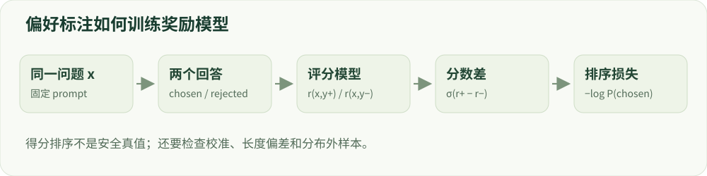

# 06 · 偏好数据与奖励模型

从“哪个回答更好”到一个有偏差的评分器。

建议学习时间：115 分钟（含阅读与练习，按个人基础调整）。

前置章节：03、04。

## 本章主要内容

- 偏好标注与 pairwise 数据
- Bradley–Terry 与排序损失
- 奖励模型、代价模型、ORM/PRM
- 准确率、校准、长度偏差和噪声
- 分布外失效与奖励投机

## 本章图解



同一问题的两个回答经评分模型与成对排序损失形成训练信号。

## 学习目标

- 理解 Bradley–Terry 偏好概率
- 区分结果奖励、过程奖励和安全代价
- 诊断奖励偏差与校准

## 相对偏好怎样变成分数？

给定同一个问题和两个回答，标注者选择更好的一个。奖励模型 rφ(x,y) 为回答打一个实数分。Bradley–Terry 模型用 σ(r_w−r_l) 表示优选回答获胜的概率，其中 σ(z)=1/(1+e^(−z))。分差越大，模型越相信优选回答更好。

训练损失为 −log σ(r_w−r_l)。当分差为零时概率为 0.5、loss≈0.693；分差为 2 时概率约 0.881。两个分数同时加 100 不改变概率，因此奖励绝对值没有天然的跨模型可比含义。交互实验会同时显示概率与损失。

## 奖励从哪里来？

奖励模型可以由语言模型加一个标量输出头得到，输入问题与回答。人工偏好和模型生成偏好都可作为监督，但需要检查一致性、歧义和噪声。安全与帮助性可分别建模，避免把“更安全但不回答任何问题”误当成所有维度都更优。

ORM 对整个结果打分，PRM 对中间步骤提供反馈。过程标签可能更细，却更昂贵，也可能把某种写法误当成正确推理。语言化推理文本只是可观察输出，不能据此断言已经读到模型全部内部决策机制。

## 评分准确率之外，还要看什么？

偏好准确率衡量正确排序比例，但不衡量置信度。例如一组预测为 0.9 的偏好，实际仅约 0.6 被人认同，说明过度自信。可以做可靠性图、分桶校准分析，并按长度、语言、风险类别拆分。小验证集上的胜出不能保证在当前策略新生成的回答上可靠。

常见捷径包括偏爱长答案、奉承语气、格式整齐，或仅用敏感词判危险。可构造内容相同但长度不同的对照，并打乱回答顺序检查位置偏差。独立人工抽检尤其要覆盖高奖励异常样本，而不仅是平均样本。

## 为什么奖励越高，回答反而可能越差？

策略优化会主动寻找奖励模型给高分的回答。训练分布中少见的模式可能暴露评分漏洞：重复某种词、添加虚假引文、无根据地肯定用户。reward 上升但独立质量下降时，应怀疑奖励投机和分布漂移，而不是继续加大训练。

可以减少过强优化、加入参考策略约束、补充当前策略分布上的标注，或使用多个互补评价。但多个评分器共享数据与偏差时，也不一定形成真正独立的监督。最终安全评价应独立于训练奖励，并保留人类复核。

## 动手：设计一张奖励体检表

对一组无害回答，分别记录正确性、帮助性、长度和总分。找出“长但错”和“短但对”的样本，观察排序是否符合规范。给模糊样本标注“不确定”，不要强迫所有偏好都同样可靠。

验收：能解释奖励模型如何训练、它在哪些分布上失效，以及为什么 reward 不应直接作为最终项目成绩。

## 技术重点：偏好标签与 Bradley–Terry

对于同一 x 的两个回答 y+、y−，奖励模型给出标量 r(x,y)。Bradley–Terry 用 σ(r+−r−) 表示选中回答被偏好的概率，训练时最小化 −logσ(r+−r−)。相同常数同时加到两个分数并不改变概率。

这种模型学习的是给定数据中的相对偏好，不能自然解释为全局质量或安全概率。样本需要同一 prompt、清晰胜出理由、标注者或裁判来源；若标注有争议，应记录分歧而不是只保留单一标签。

## 技术重点：奖励、代价与过程监督

奖励可表示任务帮助程度，代价模型可单独表示风险；结果奖励评价整段输出，过程奖励评价部分步骤。给中间步骤打分能提供更密集信号，但过程标签也会漏掉替代解法或误判。

安全规则与数值验证器只覆盖其定义的条件。验证器即使是程序，也可能被格式漏洞或未检查的隐含约束投机利用；应为高分错误和低分正确答案保留独立样本。

## 技术重点：除了排序准确率，还看什么

按风险类别、语言、长短差和来源统计 pair accuracy；在标签与样本允许时检查 Brier 或可靠性分箱；对高置信错误做人工复核。训练策略后访问的回答分布可能偏离奖励模型训练集，必须重新检查分布外有效性。

做长度反转对照：同一问题上让较短回答正确、较长回答错误，观察奖励是否仍偏好长回答。不能因 8 个测试对上得高分就宣称模型已经校准。

## 算例：排序概率与校准

若奖励差 r(chosen)−r(rejected)=2，Bradley–Terry 胜率为 σ(2)≈0.881；若给两侧都加 5，概率保持不变。预测 0.9 并非必然正确，统计大量相似置信度样本的真实胜率才能讨论校准。

排序准确率高也可能来自 chosen 总是更长。构造长度反转与同长度样本，分别报告准确率、Brier、按类别的误判及人工分歧；监督信号与验证集来源必须独立。

## 排查奖励投机

记录得分最高的若干错误回答，观察冗长、格式、重复和拒绝词是否改变评分。针对同一内容写不同风格的表达；如果分数只随风格变化而内容质量不变，需要补充反例或改进标注协议。

## 实现细节：成对偏好和噪声

成对损失只关心 r+−r−。同一问题中若高分回答更长、带固定措辞或来自特定模型，评分器可能学到这些捷径。应分层标注、做回答顺序交换和长度反转对照，并检查同一问题上的人工分歧。

不同标注者可能有合理分歧；过滤低一致性样本或使用软标签均会改变训练分布。需记录标注协议和过滤策略，不能把一个裁判标签当成无误真值。

## 实现细节：校准与分布外回归

pair accuracy 关注分差符号，Brier score 对概率误差敏感。比如一条真实 chosen 胜出、模型预测 0.8 的样本，其单条 Brier 误差为 (0.8−1)²=0.04；但单条结果不能衡量整体校准。

模型被优化后可能生成训练时没见过的回答。保留独立来源、语言、风险和长度切片，抽查高置信错误；若用同一个奖励模型反复生成和筛选，最终评测需要独立于该模型。

## 案例实操：检查奖励模型排序与校准

输入：读取 reports/tiny_lm/gpu_seed7.json 中 reward_model 的 before、train 和 heldout；检查 labs/tiny_lm/training.py 中评分头与 pair loss。步骤：按同 prompt 计算 chosen 和 rejected 分数差，再核对排序概率。

交付：对排序、置信度和样本数分别写一句解释，并设计一个长度反转测试。已有记录来自极小符号任务；heldout 很小，不能证明通用安全裁判可靠或跨任务校准。

## 代码与数据片段

局部片段：一组成对偏好的奖励损失。以下是局部教学片段，运行前需结合上下文准备变量。

```python
import torch.nn.functional as F
# chosen_scores 与 rejected_scores 按相同 prompt 一一对齐
score_gap = chosen_scores - rejected_scores
pair_probability = score_gap.sigmoid()
reward_loss = -F.logsigmoid(score_gap).mean()
```

## 论文精读问题

- [Learning to summarize from human feedback](https://arxiv.org/abs/2009.01325)：偏好数据如何训练模型以评价生成摘要？
- [LLMs Gaming Verifiers（2026，预印本）](https://arxiv.org/abs/2604.15149)：任务验证器可能通过什么捷径被投机？

## 常见误区

奖励分数的尺度和偏移受训练影响，不能把两个不同奖励模型的 8 分直接视为相同质量。

## GPU 微型模型实战

在 [实战指南](../../labs/tiny_lm/README.md) 中把本章公式连接到 CUDA 上的真实 token 训练、日志与生成。微型合成任务不代表大模型安全 benchmark。

## 检查理解

1. 奖励分数从 (2,0) 变成 (102,100)，偏好概率会怎样？

   - A. 升高
   - B. 保持不变
   - C. 降到 0.5

   答案：B。Bradley–Terry 概率只依赖分差，二者分差都为 2。

2. 策略奖励升高，但人工质量降低，应优先排查？

   - A. 奖励投机与分布漂移
   - B. 训练一定不足
   - C. 人工必然判断错误

   答案：A。代理奖励可能被策略利用，需要检查奖励对真实目标的偏离。

## 一手资料

- [Learning to summarize from human feedback](https://arxiv.org/abs/2009.01325)
- [Safe RLHF](https://arxiv.org/abs/2310.12773)
- [Datasheets for Datasets](https://arxiv.org/abs/1803.09010)
- [LLMs Gaming Verifiers（2026，预印本）](https://arxiv.org/abs/2604.15149)

本章正文的数值例子用于教学；真实微型模型的实测结果另见实战报告。
