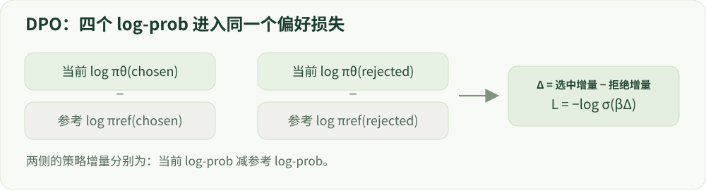

# 07 · 离线偏好优化

四个 log-prob、一条损失，以及它的适用边界。

建议学习时间：125 分钟（含阅读与练习，按个人基础调整）。

前置章节：04、06。

## 本章主要内容

- DPO 目标、四个 log-prob 与 beta
- 参考策略、隐式奖励及序列归一化
- chosen/rejected、模板与截断
- IPO、KTO、ORPO 和 SimPO 的差别
- chosen-only SFT 基线与失败诊断

## 本章图解



当前策略与冻结参考对 chosen/rejected 的四项概率，共同决定 DPO 相对目标。

## 学习目标

- 独立计算 DPO 损失
- 解释参考模型与 beta
- 区分 DPO 及代表性偏好优化变体

## DPO 用什么数据、更新什么？

一条样本包含问题 x、优选回答 y_w 和较差回答 y_l。策略模型 πθ 是要更新的模型，参考模型 πref 通常固定。分别计算两个回答在策略和参考模型下的序列 log-prob，只统计回答 token，并保持模板一致。

DPO 不需要先训练一个独立奖励模型，也不需要在标准离线训练步骤中实时生成回答。但这些优选/较差标签仍需要可靠来源。若数据来自很不同的策略分布，或者标签高度含糊，直接优化也可能过拟合或损伤能力。

## 先理解“相对参考模型的偏好差距”

记 a=log πθ(y_w|x)−log πθ(y_l|x)，b=log πref(y_w|x)−log πref(y_l|x)，则 margin=a−b，z=β×margin，L_DPO=−log σ(z)。目标是让当前策略相对参考策略，更支持 chosen 而不是 rejected。

例子：策略的 chosen/rejected log-prob 为 −2、−4，参考为 −3、−4。margin=(−2+4)−(−3+4)=1。β=0.1 时 z=0.1，loss≈0.644。初始策略等于参考模型时 margin=0，loss≈0.693，而不是零。

## 它为什么和奖励优化有关？

考虑带 KL 正则的奖励最大化：Eπ[r]−β KL(π||πref)。在理想化条件下，最优策略满足 π*(y|x)∝πref(y|x)exp(r(x,y)/β)。移项得到 r=β log(π*/πref)+只依赖 x 的常数。

对同一问题的两个回答做差，常数抵消，再放入偏好概率模型，就得到 DPO 的目标。这个联系解释了“隐式奖励”的说法，但真实神经网络、有限数据和优化误差并不满足全部理想条件，因此不能保证任意 DPO 训练都找到真实最优策略。

## beta、长度与参考策略的常见误解

在推导中的奖励目标里，更大的 β 意味着更强的 KL 惩罚。但固定一个 DPO 样本时，β 同时缩放 sigmoid 的输入并影响梯度与饱和。不能只看“β 大”就断言一次训练一定更新更小或更大；需要结合数据与训练曲线解释。

原始 DPO 使用回答序列 log-prob 的和。擅自改成平均会改变目标，也会改变长度偏好。chosen 概率可能下降而 rejected 下降更多，此时偏好差距仍然改善；因此只看 margin 不够，还要看真实生成、长度、KL 与正常能力。

## 把算法家族放到正确位置

IPO 使用不同的偏好目标，强调偏好学习中的正则化；KTO 使用可取/不可取等单回答反馈，不要求每条都是成对偏好；ORPO 将监督学习与偏好项组合；SimPO 用长度归一化的序列分数和目标 margin，并不使用显式参考模型。这些区别涉及数据要求和损失，不只是名字。

学习时先复现 DPO 核心计算，再选一个变体比较。正式比较要控制起始模型、数据和搜索预算。Online DPO 或迭代 DPO 会重新收集当前策略数据；多轮离线训练不能自动等同于 PPO 式在线策略梯度。

## 动手：翻转偏好与做对照

在实验中保持参考模型不变，逐步提高 chosen 的策略 log-prob，预测 loss 的变化。再同时给 chosen 和 rejected 加同一个常数，观察 margin 不变。运行 Python 数值脚本，与浏览器计算核对。

验收：从四个 log-prob 手算 loss；解释为何还要加入“同等预算对 chosen 继续做 SFT”的基线，以区分偏好目标与新增优质答案本身的收益。

## 技术重点：变体与参考策略

IPO、KTO、ORPO、SimPO 使用不同的监督假设或优化形式，不能当作同一 loss 的几个等价参数；SimPO 等方法对序列长度处理不同。应按论文和代码核对输入格式、参考模型、聚合方式和超参。

LoRA DPO 中 reference 可能是独立模型、冻结 adapter 副本或禁用 adapter 后的模型。哪一个才代表 SFT 起点取决于实现；训练前后比较 reference 权重与 log-prob，不要仅凭 ref_model=None 推断。

## 偏好对生成与证据链

构造偏好对时，prompt 必须相同；chosen 与 rejected 均需经过角色、事实、风险和格式审查。如果 chosen 有真实错误，模型可能学会错误；若 rejected 只是更短或更长，偏好可能退化为风格分类。训练侧与最终评测侧的模型裁判尽量独立。

实践：从共同 SFT checkpoint 分别训练 chosen-only SFT、DPO 和一个变体；记录有效回答 token、学习率搜索范围、reference、adapter 状态、逐条生成与失败样例。Tülu 3 是开放配方参考；任何效果结论应来自你自己的独立评测。

## 算例：DPO 相对目标与绝对行为

设当前 chosen 的 log-prob 比 reference 低 0.2，rejected 低 1.2，Δ=1。β=0.1 时经典 DPO loss≈0.644，比起点 Δ=0 的 0.693 更低，但 chosen 自身概率已下降。必须同时观察当前 chosen/rejected 的值和生成结果。

计算序列 log-prob 时只累加回答 token；检查相同 prompt 的 token 前缀、结束符和截断。chosen-only SFT 使用同源 chosen 答案，是区分偏好目标与新增监督数据的一个必要对照。

## 排查 reference 与 adapter

训练前对 policy 和 reference 在相同样本上的 log-prob 做一致性检查；参考冻结，并在训练后验证未变化。若用 adapter 关闭/切换来得到 reference，必须确认它代表 SFT 起点，而不是误退回原始底模。

## 实现细节：DPO 梯度方向

记 z=βΔ，单样本损失 L=−logσ(z)。对 Δ 求导为 −βσ(−βΔ)；若将 chosen 和 rejected 的策略 log-prob 当作两个独立变量，则前者的偏导为负、后者为正。但神经网络参数在样本和 token 间共享，真实更新不保证两者各自按独立变量的直觉变化。

参考模型应冻结；相同 prompt、相同 tokenizer/template 下仅聚合 completion log-prob。log-prob 求和与按长度平均是不同目标，应明确 chosen/rejected 的长度差和截断策略。

## 实现细节：变体如何比较

DPO 使用成对偏好与显式参考概率；KTO 面向可取/不可取的单回答反馈；ORPO 把监督和偏好项组合；SimPO 使用长度归一化的序列得分及目标 margin。IPO 的目标函数不同于标准 sigmoid DPO。具体实现随版本演进，阅读论文及训练库配置后再下结论。

所有方法的计算成本不完全相同。至少对齐起点、数据分组、有效 token、评测与超参搜索预算，并单列额外参考推理、生成及裁判调用。

## 案例实操：追踪真实模型的 DPO 参考策略

输入：读取 reports/real_model/sft.json 与 dpo.json；在 labs/real_model/run.py 定位 inspect_dpo。步骤：核对 DPO 输入 adapter 的哈希与 SFT 输出一致，查看 reference_unchanged、初始 loss 和 chosen/rejected log-prob。

交付：画出四个 log-prob、margin、beta、loss 和冻结 reference 的关系。项目中各训练 2 步、样本只有 8 条；它验证 reference 与标签接口，不能替代完整的安全偏好研究。

## 代码与数据片段

局部片段：标准 DPO 损失。以下是局部教学片段，运行前需结合上下文准备变量。

```python
import torch.nn.functional as F
# 每个变量是相同 batch 中 completion token 的序列 log-prob 和
policy_gap = policy_chosen_logp - policy_rejected_logp
reference_gap = ref_chosen_logp - ref_rejected_logp
margin = policy_gap - reference_gap
loss = -F.logsigmoid(beta * margin).mean()
```

## 论文精读问题

- [Direct Preference Optimization](https://arxiv.org/abs/2305.18290)：DPO 如何从参考策略与偏好概率得到目标？
- [SimPO](https://arxiv.org/abs/2405.14734)：长度归一化与不使用参考策略如何改变目标？

## 常见误区

离线偏好优化不等于数据可以不审查。错误的 chosen/rejected 会被算法认真地学进去。

## GPU 微型模型实战

在 [实战指南](../../labs/tiny_lm/README.md) 中把本章公式连接到 CUDA 上的真实 token 训练、日志与生成。微型合成任务不代表大模型安全 benchmark。

## 检查理解

1. 当策略模型与参考模型完全相同时，标准 DPO 单样本 loss 为？

   - A. 0
   - B. 约 0.693
   - C. 取决于回答长度，无法确定

   答案：B。两个模型的偏好差距相减为零，−log σ(0)=ln 2。

2. chosen 与 rejected 的策略 log-prob 同时加 1，参考不变，DPO margin 会？

   - A. 增加 2
   - B. 不变
   - C. 减少 1

   答案：B。两个策略 log-prob 做差，共同偏移抵消。

## 一手资料

- [Direct Preference Optimization](https://arxiv.org/abs/2305.18290)
- [TRL · DPO Trainer](https://huggingface.co/docs/trl/dpo_trainer)
- [A General Theoretical Paradigm to Understand Learning from Human Preferences](https://arxiv.org/abs/2310.12036)
- [KTO: Model Alignment as Prospect Theoretic Optimization](https://arxiv.org/abs/2402.01306)
- [ORPO](https://arxiv.org/abs/2403.07691)
- [SimPO](https://arxiv.org/abs/2405.14734)
- [Tülu 3 开放后训练流程](https://arxiv.org/abs/2411.15124)

本章正文的数值例子用于教学；真实微型模型的实测结果另见实战报告。
