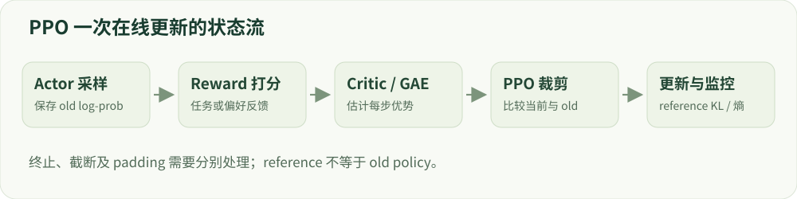

# 08 · 强化学习基础与 PPO

策略梯度、优势、裁剪与四个模型角色。

建议学习时间：130 分钟（含阅读与练习，按个人基础调整）。

前置章节：01、06。

## 本章主要内容

- MDP、轨迹与策略梯度
- 优势、价值函数与 GAE
- actor、critic、old、reference 与 reward
- importance ratio、PPO clip 和 KL
- rollout、终止边界与恢复状态

## 本章图解



PPO 在线更新：采样、反馈、优势、裁剪与参考约束。

## 学习目标

- 把文本生成映射到强化学习
- 区分旧策略、参考策略与价值模型
- 理解 PPO 裁剪的符号与作用范围

## 把回答看作一段轨迹

状态 sₜ 是问题与已生成的前缀，动作 aₜ 是下一个 token，策略 πθ(aₜ|sₜ) 是分布。回答结束时可获得一个结果奖励，也可在多个步骤得到反馈。回报 Gₜ 是未来折扣奖励之和，价值 V(sₜ) 估计当前状态预期能拿到多少回报。

策略梯度提高高优势动作的概率、降低低优势动作的概率。优势 Aₜ 表示某个动作比当前基线好多少，不等于奖励本身。一个奖励为正的回答，如果比同类选择还差，也可能具有负优势。

## 为什么需要优势和 GAE？

简单估计可以用 Aₜ=Gₜ−V(sₜ)。GAE 先计算 TD 残差 δₜ=rₜ+γV(sₜ₊₁)−V(sₜ)，再把未来残差按 (γλ) 的幂累加。γ 控制远期奖励权重，λ 调节偏差与方差的取舍。终止状态的 bootstrap 要按环境语义处理，不能把正常终止和人为截断混为一谈。

举例：一步任务奖励 1，价值预测 0.4，优势为 0.6。若价值过高估计成 1.3，优势变成 −0.3，训练信号就可能错误。价值模型需要拟合回报，因此 PPO 不只是一个 policy loss。

## 算一条三步轨迹：奖励怎样传向前面？

令三个步骤的奖励为 [0,0,1]，价值预测为 [0.2,0.3,0.4]，最后环境真正终止，γ=0.9、λ=0.95。先从各步算 TD 残差：[0+0.9×0.3−0.2, 0+0.9×0.4−0.3, 1−0.4]=[0.07,0.06,0.6]。然后倒序计算 A₂=0.6，A₁=0.06+0.855×0.6=0.573，A₀=0.07+0.855×0.573=0.559915。

第一步即时奖励虽然为零，仍能收到后续成功带来的正优势。若 λ=0，优势就等于各步 TD 残差；若 λ=1，返回的 A+V 为 [0.81,0.9,1]，对应折扣回报。若第三步只是因为采样长度限制而截断、环境并未终止，并且下个状态的价值是 0.5，则最后残差应为 1+0.9×0.5−0.4=1.05。这个差别会一路影响前面的优势。

下方 GAE 实验把每一步的奖励、价值、残差、优势和价值训练目标列在一起。它只处理一段连续轨迹；实际 batch 含多个 episode 或 padding 时，还需要明确边界 mask，不让另一个 episode 的优势传过来。

## 裁剪目标到底裁掉什么？

记 ratio=πθ(a|s)/πold(a|s)=exp(logπθ−logπold)。PPO 的 clipped surrogate 为 min(ratio×A, clip(ratio,1−ε,1+ε)×A)，通常对它取负号作为需要最小化的 policy loss。这个 min 的符号很关键，A 为负时不能直接说“超范围都没有梯度”。

例子：A=1，ratio=1.5，ε=0.2，目标被限制为 1.2；A=−1、ratio=0.5 时，目标为 min(−0.5,−0.8)=−0.8。它限制沿有利方向过度改变概率的激励，而不是强制所有概率比永远在区间内。

## 旧策略、参考策略、奖励与价值

旧策略是生成本轮 rollout 的快照，用来计算 importance ratio；参考策略常是固定 SFT 模型，用于约束长期漂移。奖励模型负责打分，价值模型预测回报。这四种角色要区分，工程上有时可以共享部分参数，但目标和使用时机不同。

一次循环是：采样问题 → 用旧策略生成回答 → 打分并计算 KL 等反馈 → 估计优势 → 对这批轨迹做有限次更新 → 刷新采样策略。重复更新同一批数据太久，会使策略与采样分布相差过大。

## 看哪些曲线才能判断训练健康？

至少看独立任务表现、reward、KL、熵、回答长度、clip fraction、价值误差和吞吐。熵快速下降可能意味着探索减少，奖励突增伴随重复文本可能是投机。不同实现的 KL 估计、奖励归一化和 token 聚合方式都可能影响数值。

先在可检查的小任务上验证优势、mask 和结束处理，再扩展到语言模型。下面的实验只计算单动作 surrogate，不包含 critic 训练或真实文本 rollout；不要把曲线当成大模型训练成绩。

## 技术重点：PPO clipping 与恢复

ratio=exp(logπθ−logπold)，目标是 min(ratio·A, clip(ratio,1−ε,1+ε)·A)。优势为负时不能沿用正优势的直觉：A=−2、ratio=1.3、ε=0.2 时两项为 −2.6 和 −2.4，较小值为 −2.6。

完整断点恢复需要 actor、critic、相应优化器/调度器、随机状态、采样权重版本以及尚未消费的 rollout；只保存 actor 权重不等于在线 PPO 恢复。观察 KL、熵、reward、clip 比例、长度和 critic loss。

## 如何判断在线训练是否失控

至少记录 reward 各分量、样本长度、EOS/截断比例、策略熵、近似或精确 KL、ratio 超界比例、critic loss 和梯度范数。KL 估计器、采样温度与策略版本须明确；单条采样的 log-ratio 可能为负，并不等于精确 KL 为负。

PPO 的恢复需保存 actor、critic、两个优化器、学习率调度器、随机状态、采样配置以及尚未消费的 rollout 状态。本项目教学实现只验证 actor/adapter 的局部恢复，不把它称为完整在线恢复；2026 RL primer 可用于检查这些概念的适用条件。

## 算例：一个两步回答的 GAE

设两个回答 token 的奖励为 r₀=0、r₁=1，价值 V₀=0.2、V₁=0.3，终止后价值为 0，γ=1、λ=0.95。δ₁=1−0.3=0.7，δ₀=0+0.3−0.2=0.1；因此 A₁=0.7，A₀=0.1+0.95×0.7=0.765。

如果第二步只是非终止截断，就需要环境定义相应 bootstrap，不能无条件使用 0。prompt、padding 和不属于动作的 token 均需用 mask 排除；报告实际实现的 token/序列聚合方式。

## 排查 PPO 实现

核验 rollout 时保存的 old log-prob、训练时对应的 token、比率和优势符号；核对 critic 的 mask 和终止值。保存 actor、critic、两套优化器、调度器、随机流和 rollout 位置后，才能讨论整体中断恢复。

## 实现细节：old、reference 和 critic 的位置

old policy 是产生当前 rollout 时的策略快照，用于 ratio 的分母；reference 是固定的对齐参考，用于约束偏离；critic 估计状态价值以计算优势或价值目标。若把 old 与 reference 混成同一个变量，PPO ratio 不再对应真实采样策略。

训练时对同一 token 前缀重算 logπθ；保存 old log-prob 与采样 mask，不要对已经更新的 actor 重算 old。若生成使用温度或过滤后的分布，应说明记录的行为概率与训练概率如何对应。

## 实现细节：轨迹 mask 与价值目标

把 prompt、生成答案、EOS 和 padding 的位置标清，优势和策略 loss 通常只覆盖动作 token。终止时 next-value 的处理不同于非终止截断；若一个 batch 包含多个 episode 或不等长样本，GAE 递推不能跨边界传播。

除了 actor loss，检查 critic loss、价值预测、梯度范数、clip 比例、KL 和回答长度。reward 上升但 KL 急剧增大或输出坍缩，应先核查日志、奖励和采样设置。

## 案例实操：从 PPO 日志还原一次更新

输入：在 reports/tiny_lm/gpu_seed7.json 中找到 ppo 阶段的 training.history；在 labs/tiny_lm/training.py 定位 train_online 与 gae_tensor。步骤：分别找 old 策略、reference、critic、奖励、KL 与 ratio_outside_clip_range。

交付：任选一个时间步，标注它的奖励、价值、下一状态是否终止和优势递推；解释损失符号。TinyLM 是教学实现，未保存完整在线 PPO 的所有恢复状态。

## 代码与数据片段

局部片段：从轨迹末尾递推 GAE。以下是局部教学片段，运行前需结合上下文准备变量。

```python
adv_next = 0.0
advantages = [0.0] * len(rewards)
for t in reversed(range(len(rewards))):
    bootstrap = 0.0 if terminated[t] else next_values[t]
    delta = rewards[t] + gamma * bootstrap - values[t]
    adv_next = delta + gamma * lam * (not terminated[t]) * adv_next
    advantages[t] = adv_next
# 此片段假设一条连续轨迹；批次、padding 和截断需额外 mask。
```

## 论文精读问题

- [Proximal Policy Optimization](https://arxiv.org/abs/1707.06347)：裁剪目标如何限制某些方向的策略更新？
- [Generalized Advantage Estimation](https://arxiv.org/abs/1506.02438)：价值估计与 λ 如何影响偏差和方差？

## 常见误区

PPO clipping 不是硬性的 KL 上限，也不等于把模型参数裁剪到一个区间。

## GPU 微型模型实战

在 [实战指南](../../labs/tiny_lm/README.md) 中把本章公式连接到 CUDA 上的真实 token 训练、日志与生成。微型合成任务不代表大模型安全 benchmark。

## 检查理解

1. A=1，ratio=1.5，ε=0.2，clipped surrogate 是？

   - A. 1.5
   - B. 1.2
   - C. 0.2

   答案：B。min(1.5×1,1.2×1)=1.2。注意优化 loss 通常是它的负号。

2. 旧策略和参考策略有什么区别？

   - A. 永远是同一个模型
   - B. 旧策略对应本批采样；参考策略通常用于长期漂移约束
   - C. 参考策略负责预测价值

   答案：B。二者在起始时可以相同，后续更新频率和用途通常不同。

## 一手资料

- [Proximal Policy Optimization](https://arxiv.org/abs/1707.06347)
- [Generalized Advantage Estimation](https://arxiv.org/abs/1506.02438)
- [Learning to summarize from human feedback](https://arxiv.org/abs/2009.01325)
- [Demystifying RL Post-Training（2026，预印本）](https://arxiv.org/abs/2608.24949)

本章正文的数值例子用于教学；真实微型模型的实测结果另见实战报告。
