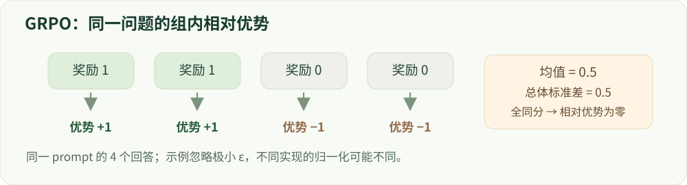

# 09 · GRPO 与在线训练

组相对优势、可验证奖励与在线采样。

建议学习时间：120 分钟（含阅读与练习，按个人基础调整）。

前置章节：08。

## 本章主要内容

- 同 prompt 多采样与组相对优势
- 均值、方差、零方差组和奖励尺度
- token/回答归一化及长度偏差
- DAPO 等变体与版本差异
- rollout 策略延迟、生成成本与日志

## 本章图解



四个奖励经组均值与总体标准差归一化，形成正负优势。

## 学习目标

- 手算组内标准化优势
- 解释同奖励组与探索的关系
- 理解 GRPO 的成本和实现变体

## 为什么让同一个问题回答多次？

给同一个问题采样 G 个回答，每个得到一个奖励 rᵢ。把它们相互比较，可以构造相对基线：Aᵢ=(rᵢ−mean(r))/(std(r)+ε)。原始 GRPO 用这类组相对信号替代单独的价值模型，并结合 PPO 风格的更新和参考策略约束。

直觉像一次同题练习：不是只看某个回答得了几分，而是看它比本组平均好还是差。原始设定会把序列级优势用于该回答的多个 token；这不代表每个 token 对成功的贡献都被精确识别。

## 从四个奖励算起

教学例子取奖励 [0,0,1,1]，均值 0.5，总体标准差 0.5，因此优势约为 [−1,−1,1,1]。这里的演示使用总体标准差；有的实现使用样本标准差、不同归一化范围或不做方差缩放，必须记录配置。

如果奖励全为 1，均值为 1，标准差为 0，所有 centered reward 也为零。加 ε 后组内优势为零，不能创造区分信息。这个组可能题目太容易、采样太单一，或者奖励器无法分辨质量；需根据证据选择更合适的任务和采样。

## 没有 critic，不代表在线训练免费

GRPO 通常省去独立价值模型，但每个问题需要多条 rollout，生成长回答往往很贵。奖励执行、参考 log-prob、KV cache、批处理和策略同步都可能成为瓶颈。G 增大可能改善比较信号，也增加成本，不能只比较训练更新的时间。

在线采样的策略版本需要与 log-prob 对应。异步系统让采样更高效，但旧数据过多会导致 off-policy 偏差。不同 GRPO 变体会改变裁剪、长度归一化、KL 项和采样筛选，报告结果时应写明具体目标而不只写“GRPO”。

## 可验证奖励的边界

数学题可以通过最终答案检查，代码题可以运行测试，这些提供相对清楚的反馈。但答案匹配可能误判等价表达，测试也可能覆盖不全。奖励必须处理解析失败、超时和无效输出，避免模型利用评测漏洞。

安全行为很难由一个关键词或二元规则完整验证。用一个安全分类器给 GRPO 打分，仍然是在优化一个有误差的模型评分，不能把它直接称为无误的 RLVR。应监测独立安全评测和合法请求质量。

## 动手：观察有信号和无信号的组

在实验中依次输入 [0,0,1,1]、[1,1,1,1]、[0,0,0,1]。解释优势的符号、极端值和组方差。再给所有奖励同时加 10，观察标准化优势不变。

学习验收：说清楚 GRPO 与 PPO 的价值基线差别，同时说明 GRPO 仍需要在线生成、奖励设计和稳定性检查。

## 技术重点：目标变体与长度偏差

GRPO 一般以组相对反馈替代独立 critic，但策略目标如何逐 token 或逐回答平均、长度是否归一化、是否包含 KL、奖励如何缩放都依赖具体实现。较长轨迹可能贡献不同数量的梯度，不能跨实现只比较算法名称。

DAPO 提出不同裁剪、动态采样、token 级损失等一组设计，用于其长推理 RL 实验。实现中的具体开关及版本需一起报告；只启用某个技巧不等于复现整篇 DAPO。

## 技术重点：rollout 与训练系统

记录 G、解码参数、每个 prompt 的生成 token、奖励计算成本、策略权重版本、同步延迟及更新次数。异步生成可能产生陈旧样本，重要性修正及过滤应明确记录。

实践中扫描 G、温度和长度时，应控制总生成/验证预算并报告全组同分、截断、KL、熵和任务表现；不能只靠平均奖励判定推理能力。

## 排查采样训练不一致

记录 rollout 引擎、权重版本、temperature/top-p、训练时重算 log-prob 的设置；策略更新太快会使旧样本偏离当前策略。必要时控制同步频率并报告修正方式，同时把采样和验证预算纳入成本。

## 实现细节：组优势如何作用于 token

一种教学形式是对每个回答 yᵢ 的各 token 计算 ratioᵢₜ 与其回答级优势 Aᵢ，取 PPO 风格的裁剪项，再对 token/回答和组求平均。采用先对每个回答平均还是直接对所有 token 平均，会让长短回答获得不同权重；KL 的形式和系数也要单独说明。

在旧策略和当前策略一致、Aᵢ=0 的组中，相对策略梯度没有组内区分信号；实现中仍可能有 KL、熵或其他项。不能仅据全同分断定这批计算在所有实现里完全没有梯度。

## 实现细节：采样分布、丢弃组和成本

生成参数、rollout 数、验证器和组筛选共同决定训练数据分布。动态采样如果移除全对/全错组，会改变问题难度分布；需要报告筛选前后 prompt 数、丢弃比例及额外生成成本。

监控相同 prompt 的回答重复率、零方差、截断与奖励分量；同时记录采样器策略版本和训练者使用的 old log-prob，避免将异步更新造成的分布偏移误认为算法收益。

## 案例实操：检查零方差组和生成成本

输入：打开 GPU 微型模型报告中 grpo 阶段，找到 rollout_group_size、generated_tokens 和 history 的 zero_variance_group_fraction。步骤：手算 [1,1,0,0] 及 [1,1,1,1] 两组奖励的均值、标准差和优势。

交付：记录零方差比例与回答长度，并说明该设置使用总体标准差和给定 epsilon。进一步扫描采样温度或组大小属于新实验，需要重新运行并控制生成预算。

## 代码与数据片段

局部片段：计算一个组的相对优势。以下是局部教学片段，运行前需结合上下文准备变量。

```python
# rewards: 同一 prompt 下 G 个回答的奖励向量
mean = rewards.mean()
std = rewards.std(unbiased=False)  # 总体标准差；与具体框架约定一致
advantages = (rewards - mean) / (std + 1e-8)
# 全部同分时 advantages 为零；这不代表任务已经解决。
```

## 论文精读问题

- [DeepSeekMath · GRPO](https://arxiv.org/abs/2402.03300)：DeepSeekMath 中组相对优势如何构造？
- [DAPO（2025）](https://arxiv.org/abs/2503.14476)：不同裁剪和动态采样分别针对什么问题？

## 常见误区

同组奖励都相同，说明当前反馈不能区分这些回答；加大 ε 并不会产生新的学习信息。

## GPU 微型模型实战

在 [实战指南](../../labs/tiny_lm/README.md) 中把本章公式连接到 CUDA 上的真实 token 训练、日志与生成。微型合成任务不代表大模型安全 benchmark。

## 检查理解

1. 组奖励 [1,1,1,1] 的标准化优势为？

   - A. 全是 1
   - B. 全是 0
   - C. 正负交替

   答案：B。每个奖励都等于组均值，中心化后为零，ε 仅用于数值稳定。

2. GRPO 省去独立 critic 后，哪项成本通常仍然很重要？

   - A. 多回答 rollout 与奖励计算
   - B. 所有成本都消失
   - C. 只剩 tokenizer 下载

   答案：A。组内比较依赖多条生成结果，长回答和复杂验证器可能使采样成本很高。

## 一手资料

- [DeepSeekMath · GRPO](https://arxiv.org/abs/2402.03300)
- [TRL · GRPO Trainer](https://huggingface.co/docs/trl/grpo_trainer)
- [DeepSeek-R1](https://arxiv.org/abs/2501.12948)
- [DAPO（2025）](https://arxiv.org/abs/2503.14476)
- [Demystifying RL Post-Training（2026，预印本）](https://arxiv.org/abs/2608.24949)

本章正文的数值例子用于教学；真实微型模型的实测结果另见实战报告。
