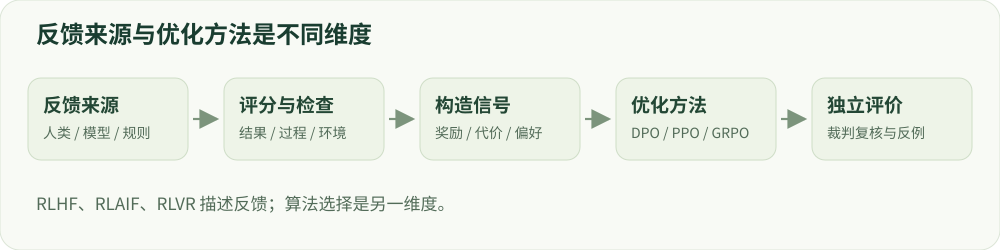

# 10 · 反馈来源与奖励设计

区分标注来源、优化算法和奖励可靠性。

建议学习时间：110 分钟（含阅读与练习，按个人基础调整）。

前置章节：06、07、09。

## 本章主要内容

- RLHF、RLAIF、RLVR 的不同维度
- 人类、模型、规则及环境反馈
- 结果/过程奖励与多目标聚合
- 验证器漏洞和 reward hacking
- 奖励审计与独立评价

## 本章图解



从反馈来源到训练信号、优化方法和独立评测的关系。

## 学习目标

- 用三个维度描述训练方案
- 设计可审计的模型反馈流程
- 识别奖励被投机利用的路径

## 它们不是三种互斥优化器

RLHF 强调来自人的反馈，RLAIF 强调来自 AI 的反馈，RLVR 强调奖励可验证性。PPO、GRPO 和 DPO 则是优化方法。一次系统可以先用人工偏好训练奖励模型，再用 PPO 更新；也可以用 AI 构造偏好对，再用 DPO 更新。

画一个三列配置表：反馈来源是什么、信号是什么、用什么算法更新。比如“规则验证器 / 代码测试通过率 / GRPO”与“人类比较 / chosen-rejected / DPO”。这样比把所有缩写放进同一张排名表更准确。

## 人工与模型反馈都需要规范

人的判断可能因专业背景和标注规范不同而分歧。先明确正确性、帮助性、安全性等维度，提供边界样例并测一致性。模型裁判则会受到提示、顺序、长度和自身偏好影响；应固定版本、交换答案位置、抽样复核。

宪法式反馈先给出一组原则，让模型批评或修订回答，并可据此产生训练信号。原则本身仍需人设计和审查，模型生成的批评也可能错误。记录原则版本和冲突处理方式，避免同一类样本在不同批次得到相反标签。

## 规则奖励也会被钻空子

一个“答案以 JSON 结束就加分”的规则可能促使模型输出空 JSON；只检查某个字符串可能奖励无意义复述。代码测试若只覆盖简单样例，模型可能通过样例却不能解决一般情况。验证器应区分格式有效、任务正确和行为允许。

组合奖励常写成 R=w₁r_correct+w₂r_format−w₃c_unsafe。先检查每项的数值范围和分布，再设置权重。某项数值天然大十倍，可能支配训练；归一化虽有帮助，也可能掩盖重要的绝对阈值。

## 不要把格式约束冒充内容验证

假设某个回答格式正确得 1 分、事实正确得 1 分。当格式分很容易获得而事实验证经常失败，模型可能停留在格式正确的低质量解。应分别记录每个子奖励及其与人工判断的相关性，检查总分提高究竟来自哪一项。

如果多目标难以用固定权重表达，可以研究约束式优化：先限制安全代价，再最大化帮助性；或者按明确优先级构造偏好。约束仍受评价器误差影响，不能把算法名称当成安全保证。

## 构造一个闭环，并给它独立检查

训练侧生成回答、打分和更新；评价侧用未参与优化的数据、不同判断方式和人工审计。遇到高 reward 低质量样本时，先记录失败类型，再决定修复规则、补标数据或降低优化强度。

练习：给一个无害的摘要任务设计“信息覆盖、事实一致、简洁”三个指标，再写出模型可能怎样投机。验收标准是既能设计奖励，也能指出它无法覆盖的行为。

## 技术重点：奖励聚合与可被投机的规则

正确性、安全、格式、长度或调用成本可能使用不同尺度。将分数线性相加前先查看各分项分布，明确冲突和覆盖规则；同时记录原始分量，以识别总分上升来自哪一个分量。

例如 R=正确性+0.1×格式分，正确回答得 1+0=1，而错误回答若格式分为 15，则总分 1.5；优化器可能偏向格式而非正确。此数值是人为构造的量纲示例，不代表某一模型实测。

## 奖励组合与 Goodhart 式失败

可将正确性、格式、安全和长度等维度分别计算，再按固定规则聚合；不要只保存最终总分，否则无法定位是哪个分量驱动了行为。单位与尺度不同会影响权重，必须报告分量的统计分布与相互冲突样例。

2026 年预印本 LLMs Gaming Verifiers 展示：在其归纳任务设置中，模型可能利用验证器只检查有限实例的漏洞，而非学到泛化规则。该研究启发我们构造等价变换和隐含约束测试，但不能直接推断所有安全裁判都存在同样失效模式。

## 排查可验证奖励

先定义输入合法性、超时、解析失败及多种正确答案的处理，再使用不可见测试和等价变换进行复核。确保验证器不能被生成文本覆盖或直接泄露答案；有状态工具应限制权限并审计副作用。

## 实现细节：多来源反馈管线

人类偏好需要标注指南、题目上下文、质量抽检及分歧仲裁；AI 反馈需要固定模型 revision、裁判提示与输出格式，并人工校准；程序反馈需要版本化执行环境、答案检查、超时和异常。三种来源都可能有噪声。

偏好标签可用于离线训练，标量反馈可用于在线 RL，环境反馈也可用于筛选生成数据。先说明反馈如何产生，再说明优化器如何使用，避免把“RLHF”当成一个具体 loss。

## 实现细节：安全奖励与拒绝捷径

单纯给“包含拒绝词”加分可能奖励先拒绝再输出不当内容，或对合法敏感请求一律拒绝。分开记录请求风险、回答行为、允许内容的任务完成度和代价，不同维度可能冲突。

验证器本身应进行对抗性的格式、语义和边界样例审计；对最终报告使用独立裁判和人工抽查。规则可验证某些客观条件，但开放语言安全判断仍可能存在不确定性。

## 案例实操：设计一个会被钻空子的奖励

输入：给一个任务定义“正确性 + 格式分”，然后构造格式分高但内容错误的回答。步骤：分开记录各分项与总分，用独立规则或人工检查判断总分是否与任务目标一致。

交付：奖励卡列明信号来源、量纲、权重、超时、错误类型和可能漏洞；再添加至少一种等价改写作为审计。示例用于理解代理目标，不证明某个正式验证器一定失效。

## 代码与数据片段

局部片段：分项记录比只保存总分更可审计。以下是局部教学片段，运行前需结合上下文准备变量。

```python
components = {"correctness": 1.0, "format": 0.0, "safety_cost": 0.0}
reward = components["correctness"] + 0.1 * components["format"]
record = {"reward": reward, "components": components,
          "validator_revision": validator_revision}
```

## 论文精读问题

- [Constitutional AI](https://arxiv.org/abs/2212.08073)：原则反馈与自我修订如何参与对齐？
- [LLMs Gaming Verifiers（2026，预印本）](https://arxiv.org/abs/2604.15149)：为什么表面上可验证的奖励也会被投机？

## 常见误区

AI 生成的偏好不自动比人工偏好客观；规则可执行也不自动意味着规则完整。

## 检查理解

1. “AI 生成偏好对，再用 DPO 训练”中，AI 反馈与 DPO 分别描述？

   - A. 同一维度的算法名称
   - B. 反馈来源与优化方法
   - C. 模型尺寸与训练精度

   答案：B。来源、信号形式和优化器需要分别记录。

2. 奖励由正确率和格式分相加，最先需要检查？

   - A. 各项量纲、范围和可投机性
   - B. 格式分越大越好
   - C. 只要和为 1 就可靠

   答案：A。不同尺度会改变真实优化方向，规则还可能被模型利用。

## 一手资料

- [Constitutional AI](https://arxiv.org/abs/2212.08073)
- [Tülu 3 开放后训练流程](https://arxiv.org/abs/2411.15124)
- [TRL · GRPO Trainer](https://huggingface.co/docs/trl/grpo_trainer)
- [LLMs Gaming Verifiers（2026，预印本）](https://arxiv.org/abs/2604.15149)
- [Demystifying RL Post-Training（2026，预印本）](https://arxiv.org/abs/2608.24949)

本章正文的数值例子用于教学；真实微型模型的实测结果另见实战报告。
