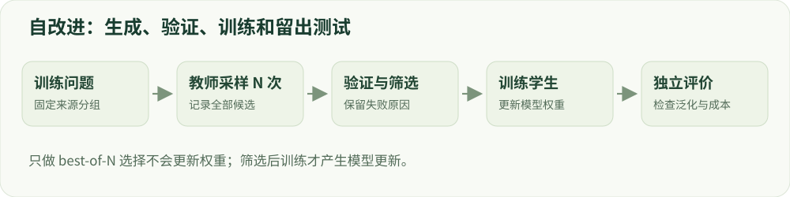

# 11 · 推理后训练与自改进

把更多生成计算，转化为可学习的数据。

建议学习时间：115 分钟（含阅读与练习，按个人基础调整）。

前置章节：04、09、10。

## 本章主要内容

- 冷启动、长思考与任务分布
- 结果监督、过程监督与验证器
- best-of-N、拒绝采样和计算预算
- 序列/软标签蒸馏与自训练
- 迭代筛选、覆盖率与数据退化

## 本章图解



教师采样、验证筛选、学生更新与独立评测的闭环。

## 学习目标

- 区分 best-of-N 与权重训练
- 理解软标签和序列蒸馏
- 设计带去重与质量控制的迭代流程

## 多想几次与训练，是两件事

best-of-N 为一个问题生成 N 个候选，再用评分器选择一个；多数投票根据答案一致性选择。它们增加推理计算，但没有直接改变模型权重。若把筛选出的回答加入训练集再做 SFT，则成为拒绝采样微调的一种形式。

如果每次独立尝试的成功率是 p，至少一次成功概率为 1−(1−p)^N。这个公式依赖独立、同分布假设，也假设能知道哪次成功。真实回答常相关，评分器也可能选错，所以它只提供教学直觉，不能当成实际收益预测。

## 蒸馏把教师信息传给学生

序列蒸馏使用教师生成的回答作为监督；软标签蒸馏则让学生分布逼近教师的概率分布，常用交叉熵或 KL。软标签保留了教师对其他选项的不确定性，但需要能获得相应输出分布并处理词表等兼容问题。

教师并不是无误的真值。教师幻觉、偏见和拒绝倾向可能被学生继承。筛选时既要看正确率，也要看长度、覆盖和多样性。离线教师数据与学生自身生成的前缀分布不同，on-policy 蒸馏试图在学生访问的状态上提供反馈，但增加采样和教师成本。

## 推理训练中的结果与过程

结果监督检查最终答案，过程监督检查中间步骤。错误中间步骤偶然得到对答案，结果奖励可能看不出来；过程标签也可能误伤另一种正确解法。长推理轨迹使信用分配、长度成本和截断更加突出。

冷启动数据可以教会格式和基本行为，后续强化学习优化可验证任务表现。增加思考 token 并不保证质量；需要比较同一计算预算下的成功率。展示的推理文本应作为输出行为评估，不能当作内部推理的完整证据。

## 用一次小实验区分生成收益和学习收益

保留一批完全没参与生成筛选的题目。先测原模型单次回答和 best-of-N，再用筛选数据训练学生，最后测学生单次回答。若学生仅在训练题上提升，可能只是记忆；若教师增加采样的收益远高于学生，说明蒸馏没有完整保留教师行为。

比较时分别记录教师生成 token、筛选成本、学生训练 token 和评测时的采样预算。一个更强教师或更多生成预算，都可能解释收益；需要在报告里明确，而不能全部归因于蒸馏算法。

## 自改进需要防止数据越转越窄

一个受控循环是：选训练侧问题 → 采样候选 → 验证与筛选 → 去重 → 保留来源 → 混合旧数据 → 更新 → 独立评测。若只保留模型最自信的常见模式，数据多样性可能下降，错误也可能循环放大。

练习：设计两轮无害算术问答数据迭代，记录原始题目簇、教师/学生版本、筛选规则及新增有效样本量。将定向挖掘与等量随机新增比较，才能知道收益是否来自迭代机制而不是多训练了一轮。

## 技术重点：冷启动与推理轨迹

冷启动数据为后续训练提供格式或初步任务行为，结果监督关注最终答案，过程监督评价中间步骤。过程标签可能遗漏另一种正确路径，也不能保证最终答案正确；需单独研究标注噪声和长度成本。

DeepSeek-R1 公开了不同阶段的推理训练研究；Qwen3 讨论 thinking/non-thinking 模式。可展示的推理文本属于模型输出，不能直接等同于模型内部完整推理过程。

## 推理模型的多阶段路径

DeepSeek-R1 报告先研究直接 RL，再引入冷启动数据及多阶段训练；Qwen3 技术报告讨论 thinking 与 non-thinking 的联合模型。把“模型会输出推理文本”直接等同于推理真实可靠或安全是不成立的；需要独立检查答案、推理过程的可信度与最终行为。

thinking 模式会改变生成长度、延迟和 token 预算；与非 thinking 模式比较时，明确是否允许等量推理 token、是否保留中间内容、如何处理截断。不要把闭源模型的内部配方当作已公开事实。

## 排查自训练数据闭环

每个生成样本保留原 prompt ID、教师 revision、采样参数、验证版本和拒绝原因；空候选不能用标准答案偷偷填补。按难度与类别检查通过率；如只有简单题被接受，迭代可能使数据分布越来越窄。

## 实现细节：离线和在线蒸馏

序列蒸馏用教师生成文本作为 token 监督；分布蒸馏通常比较教师和学生在某些前缀上的概率分布，需要处理不同词表、温度、精度和 teacher 成本。离线数据来自固定教师分布，在线方法可能在学生访问的前缀上取教师反馈。

无论用哪种方式，教师错误与偏见都可能进入学生。记录教师模型和版本、解码参数、候选与筛选结果；评测时区分单次学生输出与增加多次采样带来的测试时计算收益。

## 实现细节：自改进的覆盖和选择偏差

对于每个 source prompt 记录生成数、通过数、失败原因和最终选择；一些难题没有通过候选时，训练集会向容易题偏移。比较有目标挖掘和随机扩充时，应对齐新增样本、有效 token 与生成/验证成本。

以未参与选择的独立组验证是否泛化，同时保留生成失败与负结果；如果用测试结果再次选择教师或改筛选阈值，该测试已参与开发。

## 案例实操：核对生成—筛选—训练的证据

输入：读取微型模型 distill 阶段的 selection 字段，包括 candidates、generated、accepted、selected 和 teacher_gate。步骤：核对候选数量、教师选择和筛选规则，确认没有接受样本时不会悄悄插入标准答案。

交付：计算接受率和 prompt 覆盖率，分别写出教师生成预算、学生训练预算及未覆盖问题。该实验使用同架构模型；它展示闭环，不证明模型压缩或复杂推理能力提升。

## 代码与数据片段

局部片段：保留没有通过的情况。以下是局部教学片段，运行前需结合上下文准备变量。

```python
accepted = [candidate for candidate in candidates
            if verifier(candidate)["accepted"]]
selected = accepted[0] if accepted else None
record = {"candidates": candidates, "selected": selected,
          "validator_revision": validator_revision}
# 不把标准答案作为教师的生成结果。
```

## 论文精读问题

- [DeepSeek-R1](https://arxiv.org/abs/2501.12948)：冷启动、强化学习和蒸馏各承担什么作用？
- [Qwen3 Technical Report（2025）](https://arxiv.org/abs/2505.09388)：thinking 与 non-thinking 的训练/推理接口如何区分？

## 常见误区

挑出了一个正确答案，不代表模型已经学会；只有更新权重并在独立问题上验证，才能谈训练收益。

## GPU 微型模型实战

在 [实战指南](../../labs/tiny_lm/README.md) 中把本章公式连接到 CUDA 上的真实 token 训练、日志与生成。微型合成任务不代表大模型安全 benchmark。

## 检查理解

1. 仅对同一个问题采样 8 次并挑选最佳回答，是否更新了权重？

   - A. 是
   - B. 否
   - C. 取决于回答长度

   答案：B。采样与选择属于推理过程，需额外训练步骤才会更新权重。

2. 独立单次成功率 0.5，尝试两次至少成功一次的概率为？

   - A. 0.5
   - B. 0.75
   - C. 1

   答案：B。1−(1−0.5)²=0.75；现实的相关采样和不完美选择器可能降低收益。

## 一手资料

- [Distilling the Knowledge in a Neural Network](https://arxiv.org/abs/1503.02531)
- [DeepSeek-R1](https://arxiv.org/abs/2501.12948)
- [Tülu 3 开放后训练流程](https://arxiv.org/abs/2411.15124)
- [Qwen3 Technical Report（2025）](https://arxiv.org/abs/2505.09388)
- [Olmo 3 技术报告（2025）](https://arxiv.org/abs/2512.13961)

本章正文的数值例子用于教学；真实微型模型的实测结果另见实战报告。
