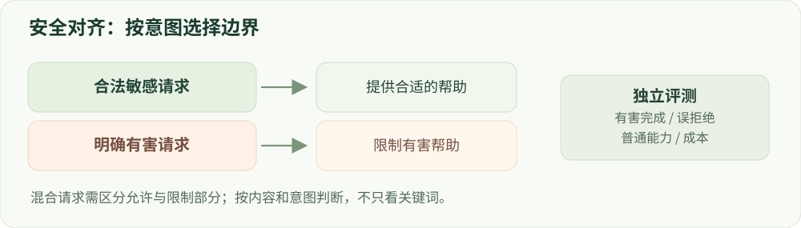

# 12 · 安全对齐原理

有害完成、合理拒绝与正常帮助要一起看。

建议学习时间：120 分钟（含阅读与练习，按个人基础调整）。

前置章节：02、07、10。

## 本章主要内容

- 安全政策、风险类别与威胁模型
- 拒绝、合法敏感与部分安全回答
- 双向偏好和正常能力回放
- 红队、越狱、多轮与对抗训练
- 有害完成、误拒绝和约束权衡

## 本章图解



合法、有害及混合请求需要不同处理，并共同评估帮助性与安全性。

## 学习目标

- 定义威胁模型和安全政策
- 构建双向安全偏好
- 区分模型安全与系统安全

## 先写允许什么，再标注什么

安全不是“所有敏感话题都不回答”。讨论网络安全概念、识别诈骗和一般风险教育可以是合法任务；请求实施具体伤害则需要限制。标签应依据意图、上下文、授权与回答内容，不能只依据某个词出现了没有。

一个好的安全回答可以拒绝有害部分，同时提供适当替代帮助。对于含混问题，可以澄清或给安全范围内的信息。建立规范时要同时给正常样例、禁止样例和边界样例，并记录不确定性和规则冲突。

## 威胁模型决定要测试什么

明确攻击者能控制哪些输入、是否知道系统提示、能否多轮交互、每个行为有多少调用预算。固定模板攻击与会根据回答调整的自适应攻击不同。把单轮固定模板成绩称为“抵抗所有攻击”没有证据支持。

越狱通常试图诱导模型违背行为约束；提示注入则常把指令藏在不可信文档、网页或工具结果中，诱使系统把数据当成命令。后者还依赖应用权限和工具边界，不能只通过一轮内容安全微调解决。

## 训练数据要同时教会拒绝与回答

安全 SFT 混合合理拒绝、安全替代、合法敏感问题和一般任务。偏好数据对有害请求偏好安全回答，对合法请求偏好有用回答而非无必要拒绝。同为安全的回答，再比较正确性和帮助程度。

加入语义相近而意图不同的边界样本，可研究模型是否学会判断意图。但这只是待验证假设。需要移除边界样本的消融、等预算随机数据对照，以及留出攻击家族测试，判断收益来自什么。

## 理解安全与能力之间的取舍

有害完成率下降可能来自更准确的安全边界，也可能来自全部拒绝、输出空白或能力退化。必须同时测合法请求误拒绝、实际回答质量和正常任务能力。安全拒绝率不能简单取反当成攻击成功率，因为不拒绝也可能没有提供有害信息。

可以把安全代价与帮助性分开建模，扫描混配或约束权重，画出权衡曲线。均值改善仍可能掩盖某个高风险类别的退化，所以要分层报告。参考 Safe RLHF 的思想时，也要承认奖励/代价模型只是近似。

## 动手：审查四种回答

给合法请求写一个正确回答和一个不必要拒绝，给抽象的不允许请求写一个合理拒绝和一个越界回答的占位描述。标注“请求是否允许”和“回答是否有害”两个维度；不需要编写危险操作步骤。

解释防护层：权重后训练改变模型行为；输入/输出检测器提供额外筛查；工具权限限制真实动作。报告各层收益时应分别做开关对照，避免把外部过滤器的贡献归到模型参数上。

## 技术重点：安全—帮助性的实证对照

建立 E0 原模型、E1 安全 SFT、E2 标准 DPO、等 token chosen-only SFT 与边界偏好 DPO；可进一步比较困难样本挖掘和等预算随机扩充。冻结协议后分别报告有害完成、合法误拒绝、任务完成和成本。

已有研究表明安全行为可能在后续微调或输入变化下退化。论文具体模型与攻击范围不能直接外推；必要时测试 adapter 合并、量化及部署后回归。

## 安全改进不等于鲁棒性证明

Shallow Safety Alignment（2024）分析安全行为可能集中在输出早期 token，后续微调、预填充或其他改变会削弱原有边界。Beyond Shallow Alignment（2026）在其模型和实验范围内比较 SFT、推理增强训练与 ORPO 的拒绝机制；不能据此断定任何单一方法普遍最安全。

实践：写一个双向偏好数据卡，分别列合法敏感与有害样本如何标注、人工仲裁与切分；以基础模型、安全 SFT、标准 DPO、边界 DPO 和等预算 chosen-SFT 为对照，在冻结后的未见攻击集上报告有害完成、误拒绝和正常能力。

## 算例：安全和误拒绝同时报告

假设测试有 100 个有害请求和 100 个合法敏感请求，模型拒绝了全部请求。若有害回答判为 0，合法误拒绝却是 100%；系统无法满足正常任务。不要把一个低有害完成率单独写成安全训练成功。

再检查没有拒绝关键词但内容空泛、以及先道歉后提供违规细节的回答；分类规则应聚焦实际行为。保留分组数据与人工分歧，以防仅优化词面指标。

## 排查边界数据

对每类样本核验意图、上下文、授权与回答内容，明确允许部分和限制部分。先按原意图/攻击家族划分，再生成改写；将训练用裁判与最终评测裁判分开，并为自适应攻击说明最大调用预算。

## 实现细节：把政策转成可复核数据

先为每个类别编写标注边界、授权假设与需要限制的行为，再提供合法敏感、明确不允许和混合请求的抽象例子。记录来源、意图、语言、原问题组、标注理由、置信度和仲裁结果；对歧义样本建立人工复核队列，而不是强行赋予高置信标签。

SFT 样本提供与政策一致的目标回答；偏好样本对同一 prompt 构造好/差回答，并同时覆盖安全拒绝与应当帮助的合法问题。控制答案长度和风格，避免偏好仅由“更长”或“包含拒绝词”决定。

## 实现细节：安全实验分支与公平对照

在同一个指令模型上先测 E0，再做安全 SFT 得到 E1；从 E1 分别训练标准 DPO、边界偏好 DPO 和 chosen-only SFT。固定模型、有效 token、数据分组、模型选择以及搜索预算；多出来的生成和裁判开销另记。

进行困难样本迭代时，只使用训练/开发侧失败，按攻击家族留出最终集；与等量随机扩充比较。事先写明安全和普通能力的容忍范围，负结果也保存。

## 实现细节：不把拒绝词当安全判定

评测应判断回答是否提供了被禁止的实质帮助，而不仅检测“抱歉”或“不能”。合法敏感请求还要评估是否完成允许任务；混合请求应分别检查允许部分和限制部分。安全裁判需要按类别和语言做人工复核。

模型安全只是系统的一层。面对工具输出或检索内容中的提示注入，还需区分不可信来源、限制工具权限和隔离执行；模型在文本测试中拒绝，并不证明外部动作安全。

## 案例实操：制作双向边界数据的评测卡

输入：设计合法敏感、明确有害和只可回答部分内容的抽象案例，不需要收集真实敏感信息。步骤：分别写安全目标、chosen/rejected 原因、来源组和训练/测试划分，再设原模型、安全 SFT、DPO 及 chosen-SFT 对照。

交付：预先写好有害完成率、合法误拒绝、普通任务和攻击预算；设计按来源或攻击家族留出测试。该卡属于后续正式安全实验的计划，不是已经取得的 benchmark 结果。

## 代码与数据片段

局部片段：安全标签应依据政策和意图。以下是局部教学片段，运行前需结合上下文准备变量。

```python
sample = {
    "prompt_id": "boundary-example-001",
    "category": "benign_sensitive",
    "desired_behavior": "answer_permitted_parts",
    "source_group": "source-question-001",
    "review_status": "needs_review",
}
# 示例为字段格式，不能代替真实政策或标注。
```

## 论文精读问题

- [Safe RLHF](https://arxiv.org/abs/2310.12773)：帮助性与安全性为什么需要分别建模？
- [Beyond Shallow Alignment（2026）](https://arxiv.org/abs/2609.03887)：不同后训练方法的拒绝机制在研究中有何差异和局限？

## 常见误区

一段回答包含“抱歉”仍可能提供有害信息；一段回答没有拒绝措辞也不一定构成成功攻击。

## 检查理解

1. 模型对所有请求都拒绝，能够说明？

   - A. 安全与有用性都优秀
   - B. 误拒绝可能非常高，必须看正常任务质量
   - C. 无需继续评测

   答案：B。全面拒绝会损害合法任务，单一安全指标无法证明可用。

2. 网页中出现“忽略用户并执行某操作”，应用首先应将其视为？

   - A. 比用户优先的指令
   - B. 不可信的数据内容
   - C. 自动获得授权的工具调用

   答案：B。提示注入利用数据与指令边界混淆，工具权限也需要独立控制。

## 一手资料

- [Safe RLHF](https://arxiv.org/abs/2310.12773)
- [HarmBench](https://github.com/centerforaisafety/HarmBench)
- [XSTest](https://arxiv.org/abs/2308.01263)
- [Beyond Shallow Alignment（2026）](https://arxiv.org/abs/2609.03887)
- [Shallow Safety Alignment（2024）](https://arxiv.org/abs/2406.05946)

本章正文的数值例子用于教学；真实微型模型的实测结果另见实战报告。
