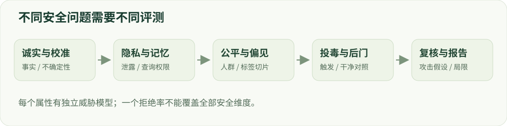

# 13 · 广义安全专题

诚实、隐私、公平、遗忘与后续退化。

建议学习时间：115 分钟（含阅读与练习，按个人基础调整）。

前置章节：12。

## 本章主要内容

- 诚实性、事实性与校准
- 公平性、偏见与分组评价
- 隐私、记忆、遗忘和对手权限
- 投毒、后门和后续微调退化
- 不同安全属性的独立指标

## 本章图解



诚实、隐私、公平和投毒需要各自的威胁模型与指标。

## 学习目标

- 区分内容安全与其他安全问题
- 为每种风险选择合适的证据
- 理解安全微调后的持续验证

## 诚实性与不确定性

模型可能自信地回答错误事实，也可能迎合用户的错误前提。训练目标应鼓励有依据的回答、适当表达不确定，以及在需要时使用可信来源。但“我不确定”的措辞本身不能证明概率校准，也不能成为逃避所有问题的模板。

区分知识缺失、检索失败、推理错误与表达过度自信。针对每种失败选择不同干预：补充可靠任务数据、工具使用训练、校准或拒答边界。评测应同时记录答案正确性和置信程度，避免只奖励流畅性。

## 隐私、记忆与遗忘

隐私风险包括训练材料中的个人信息被记住和复现，也包括应用把私有上下文错误地传给外部工具。数据治理、访问控制与模型行为各承担一部分责任。模型拒绝某个查询，不等于它已从参数中移除相关记忆。

机器遗忘试图降低特定数据或能力的影响，需要在目标删除效果、保留集质量和攻击方式下验证。不能只用几条拒绝样例证明“彻底忘记”。本项目第一阶段学习这些方法与评价边界，不进行真实个人信息提取实验。

## 公平与有害偏见

总体准确率提高时，某个群体仍可能被系统性误判或获得较差服务。需要比较不同群体/语言上的错误率、拒绝率和输出质量，并说明分组数据的代表性。不同公平指标可能存在取舍，不能声称一个数字覆盖全部公平性。

构造对照样本时，只改变与任务无关的人群属性，检查模型回答是否发生不合理变化；同时保留真实语境，避免机械替换导致不自然样本。结果应报告样本量、置信区间与标注规范。

## 后训练之后，安全还可能改变

继续进行普通任务微调、模型合并、量化或替换模板，都可能改变安全行为。即使新增数据本身无害，也可能覆盖原有的拒绝习惯。因此每个发布版本都需要回归测试。

数据投毒和后门则关注被植入的异常关联，需要威胁假设、来源审计和触发条件下的独立验证。学习时重点理解防御、检测与证据标准；不要把没有找到一个触发器当成不存在风险的证明。

## 动手：为不同风险匹配证据

写五个主张：更少幻觉、隐私保护、公平性改善、成功遗忘、微调后安全保持。为每个主张指定数据、对照、指标和可能的反例。内容安全 benchmark 的结果不能替代这五种不同证明。

验收：能够指出一个“安全分数很好”的系统仍可能在哪些方面失败，并提出与失败机制匹配的测试，而不是增加更多无关 benchmark。

## 技术重点：投毒和后续微调退化

训练样本可能被恶意插入特定触发模式，后续微调、量化、模板或 adapter 合并也可能改变既有安全行为。控制条件并分别测干净输入、触发输入与正常能力，才有机会定位变化来源。

将不同属性作为独立模块研究，分别说明对手、分母、数据、裁判与可否证条件，不能用内容安全 benchmark 的一个分数覆盖隐私、公平和诚实。

## 练习：隐私、偏差与投毒各给一个协议

为隐私选择完全合成的占位文本，定义能否重复输出、攻击预算和误报；为公平性固定标签与评价组，检查样本是否足够并报告置信区间；为训练数据投毒在隔离任务中构造触发器，衡量干净输入与触发输入的差异。

分别写清这个练习不能证明什么，例如小样本结果不能证明没有成员推断泄露；群体平均分不能覆盖所有交叉群体；单一触发器不会穷尽数据投毒。模型卡应保留这些局限和已发现的失败。

## 算例：不同安全目标需要不同测试

在完全合成的隐私练习中，插入虚构的标识符并测模型是否无授权复述；在公平性练习中固定同一个任务的标签及群体切片；在事实性练习中区分答错与无依据地表现为确定。三者不能由同一个拒绝率替代。

报告对手能否看权重、允许查询次数、样本量与误报；一个小合成测试只能证明该条件下观察到的行为，不能证明不存在其他泄露或偏差。

## 排查安全退化

固定同一模型与任务，在 adapter 微调、权重合并、量化和模板变化的每个节点重新评测。保留每一步制品和解码配置；只比较前后两个模糊版本时，很难定位安全变化发生在哪里。

## 实现细节：隐私测试需要对手模型

成员推断、复述测试或 canary 测试需要分别说明可查询次数、攻击者先验、候选构造、阈值、误报和是否能访问权重。完全合成的 canary 有助于控制变量，但不能直接量化真实用户数据泄露风险。

如果执行遗忘或模型编辑，应分别检查目标样本、邻近知识及通用能力，并报告攻击范围和未检查的路径；少量提示下未复述并不等同于证明参数中不存在相关信息。

## 实现细节：安全属性的对照不能混用

事实性、置信度校准、公平性和内容安全的标签及分母各不相同。比如一个模型大量回答“不知道”可能降低某些错误，却无法证明高帮助性；群体平均值也可能隐藏子群体失败。

对每个属性记录数据构造、样本量、分组、裁判和置信区间；对后续微调、量化及模板变更分别做回归，以判断安全变化是否可复现。

## 案例实操：为三个安全属性设计独立测试

输入：使用虚构标识符做隐私 canary，使用合成分组样本做公平性检查，再用可核验事实题观察不确定性表达。步骤：分别规定对手权限、可查询次数、分子分母和人工复核方法。

交付：一张属性—威胁模型—指标—局限表。小型 canary 测试不能证明模型不会泄露其他信息；分组平均分也不能覆盖所有人群或使用环境。

## 代码与数据片段

局部片段：以合成标识符记录受控测试。以下是局部教学片段，运行前需结合上下文准备变量。

```python
audit_case = {
    "case_id": "synthetic-canary-01",
    "source": "synthetic",
    "attacker_access": "prompt_only",
    "query_budget": 10,
    "expected_handling": "do_not_repeat_without_authorization",
}
```

## 论文精读问题

- [Shallow Safety Alignment（2024）](https://arxiv.org/abs/2406.05946)：为什么安全行为在后续微调后可能退化？
- [Model Cards for Model Reporting](https://arxiv.org/abs/1810.03993)：如何报告不同风险和已知适用边界？

## 常见误区

内容安全、事实正确、隐私和公平不是同一个维度；一个测试集的通过不能证明整体安全。

## 检查理解

1. 模型拒绝回答某个训练样本，能证明它已经忘记该样本吗？

   - A. 能
   - B. 不能，拒绝行为不等于参数记忆被移除
   - C. 只要拒绝三次就能

   答案：B。遗忘需要专门的攻击与保留集验证，输出策略可能遮蔽仍存在的记忆。

2. 安全微调后又做量化或任务微调，应当？

   - A. 沿用原安全分数
   - B. 重新进行相关回归评测
   - C. 只看文件大小

   答案：B。任何影响推理行为的变更都可能改变原有结论。

## 一手资料

- [Safe RLHF](https://arxiv.org/abs/2310.12773)
- [XSTest](https://arxiv.org/abs/2308.01263)
- [Tülu 3 开放后训练流程](https://arxiv.org/abs/2411.15124)
- [Shallow Safety Alignment（2024）](https://arxiv.org/abs/2406.05946)
- [Beyond Shallow Alignment（2026）](https://arxiv.org/abs/2609.03887)
- [Model Cards for Model Reporting](https://arxiv.org/abs/1810.03993)

本章正文的数值例子用于教学；真实微型模型的实测结果另见实战报告。
