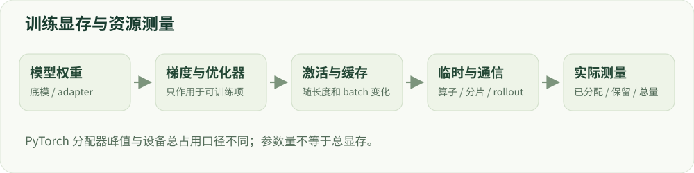

# 14 · 训练系统与效率

显存、吞吐、分布式与可恢复训练。

建议学习时间：120 分钟（含阅读与练习，按个人基础调整）。

前置章节：05、08、09。

## 本章主要内容

- 权重、梯度、优化器与激活显存
- BF16/FP16、梯度累积和 checkpointing
- ZeRO/FSDP 与数据/张量/流水线并行
- rollout、采样同步及推理系统
- GPU 峰值、吞吐和故障恢复

## 本章图解



显存由权重、梯度、激活、临时张量和缓存共同构成。

## 学习目标

- 拆分训练显存组成
- 理解梯度累积与分布式策略
- 记录成本并定位常见故障

## 显存不只是模型权重

显存通常包括权重、梯度、优化器状态、激活、临时张量和缓存。以一种传统混合精度 Adam 配置为例，若每参数有 2 字节权重、2 字节梯度、4 字节主副本和 8 字节一二阶状态，共约 16 字节/参数；这只是特定配置的静态状态估计。

7B 参数按此估算约 112GB（十进制），还未计激活和临时开销。不同框架、优化器、精度和分片会改变它。下方计算器把假设明确列出，输出不能作为某张显卡一定能跑的保证；最终要做实测。

## 有效 batch 与长度一起决定工作量

有效 batch 常为 micro_batch × gradient_accumulation × data_parallel_workers。梯度累积让多次前向/反向之后再更新，减少一次需要放进显存的样本，但不自动减少总计算。不同长度和 mask 下，还需按有效 token 归一化。

序列长会增加激活和注意力计算成本；梯度 checkpointing 通过重新计算部分前向降低激活存储。BF16/FP16 改变数值范围与精度，需要检查设备支持和数值稳定。OOM 的解决顺序通常先看长度、micro batch、缓存和重复模型，再决定是否分片。

## 并行方式各解决什么？

数据并行让不同设备处理不同样本，然后同步梯度。张量并行拆分一个算子的张量；流水线并行把模型层放到不同设备，安排微批次流动。序列/上下文并行关注长序列的分布式处理。这些方式可组合，但通信和负载均衡会影响收益。

ZeRO 的不同阶段依次分片优化器状态、梯度和参数；FSDP 也提供参数等状态分片方案。分片能减少每卡常驻状态，但仍有 all-gather、通信缓冲和峰值开销。不能把总显存简单除以卡数就当成运行峰值。

## 在线训练还有生成系统

SFT 主要读固定数据，在线 RL 要不断生成、打分并更新。采样服务与训练服务如何共享 GPU，策略权重多久同步，KV cache 如何分配，都影响吞吐。奖励验证器慢时，增加训练 GPU 未必解决瓶颈。

记录每阶段耗时、生成与训练 token 数、GPU 小时和评分成本。吞吐对比要固定模型、上下文、输出长度和硬件；否则 tokens/s 数字无法解释。不要为了看起来更快而悄悄减少评测长度或样本。

## GPU 实战的设备与精度

当前实战主流程使用 CUDA GPU 和 FP32。先确认目标 GPU 与驱动可访问，安装兼容的 CUDA 版 PyTorch，再运行 python -m labs.tiny_lm.run --check-device。入口仅接受 cuda 或 cuda:N，检查失败时修复环境。

正式运行显式指定 --device cuda，并核对报告中的设备、精度、GPU 同步耗时与阶段峰值显存。显存峰值仅统计 PyTorch 分配器，包含阶段开始已驻留模型和缓存，不含 CUDA 上下文及非 PyTorch 外部库显存；不能当作全进程总显存或算法独占占用。BF16、QLoRA 和多卡在本课程中保留原理与扩展设计，未由此宣称实现。

## 最小调试顺序与恢复

先验证一条数据 → 一个 batch → 一次更新 → 保存/加载 → 短程过拟合 → 完整实验。NaN 检查数值与空 mask；loss 正常而输出异常检查模板；多卡挂起检查 rank、collective 和输入长度；恢复后曲线跳变检查 optimizer、scheduler 与随机状态。

交付时保存代码 commit、依赖、模型与数据 revision、随机种子、完整配置、日志、checkpoint 和运行命令。只保存权重能够继续推理，却未必能够精确恢复训练。

## 技术重点：精度、batch 与计算交换

BF16 与 FP16 的指数范围不同，FP16 训练经常配合梯度缩放；选用 BF16 前需检查硬件支持。micro batch × 梯度累积 × 并行设备数给出常见的样本级有效 batch 估算，但尾批和不同长度使真实有效 token 需要另计。

gradient checkpointing 用重复前向计算换更少的激活内存；Flash Attention、序列打包和量化等优化的效果依赖版本与输入形状，必须在目标条件下测显存和吞吐。

## 技术重点：分布式与在线生成

数据并行复制模型处理不同样本；ZeRO/FSDP 按配置切分参数、梯度或优化器状态；张量并行切分层内运算，流水线并行切分层间阶段。它们各引入不同通信和同步成本，不应把名称直接等同于固定加速比。

在线 RL 中生成服务和训练服务可能共享 GPU、交换权重并使用不同批次；需记录策略同步延迟、生成预算和 KV cache。中断恢复要覆盖训练和采样系统的真实状态。

## 算例：显存和有效 batch

1.7B 参数使用 BF16 时，理想化权重存储约为 1.7×10⁹×2=3.4×10⁹ 字节，约 3.17 GiB；这还没有激活、优化器、梯度、临时张量和框架开销。单卡 batch=1、累积 8 次通常每 8 个 micro step 更新一次，最后尾批处理要单独核对。

可变长度样本还要求记录有效监督 token；同为 8 个样本的两个 batch 可能相差数倍 token。通过同步后的计时、PyTorch 分配器峰值及系统级 GPU 占用分别观测，不把三者混为一个数字。

## 排查 OOM 与吞吐

先缩短最大长度、micro batch 或生成长度，再检查梯度累积、checkpointing、KV cache 和其他 GPU 进程。固定评价质量后再比较吞吐；降低输出长度或跳过裁判会改变任务，不是单纯的系统优化。

## 实现细节：静态状态与动态峰值

以一种常见全参 AdamW 混合精度配置为例，可能存在低精度权重/梯度、高精度主权重与两份优化器状态；各自 dtype、分片和是否使用主副本取决于框架，不能无条件套用固定“每参数 16 字节”。再加上激活、缓存、通信与临时工作区，训练峰值可能远高于静态估算。

CUDA 分配器的 allocated 表示已分配张量内存，reserved 还包含缓存；它们不等同于整个设备占用。每个阶段开始前同步并重置峰值、结束后同步，报告是否包含已驻留模型和其他进程。

## 实现细节：吞吐、累积与恢复

记录有效监督 token/s、总输入 token/s、生成 token/s 的分母与计时范围。梯度累积改变 optimizer 更新间隔，但不同长度 micro batch 的 loss 加权方式可能影响等价性；空监督或不完整尾批不能悄悄算入同一预算。

SFT 的恢复需要模型、优化器、调度器、随机状态与数据位置；PPO/GRPO 还要考虑 rollout、采样器和策略版本。仅重载 adapter 并生成一次，不能证明训练可从中断处继续。

## 案例实操：读取真实训练的显存与时间

输入：比较 reports/real_model/sft.json 和 dpo.json 的 environment、gpu_peak_allocated_bytes、gpu_peak_reserved_bytes、elapsed_seconds_after_model_load 与 run_config。步骤：将字节除以 2²⁰ 得 MiB，并确认 batch、长度、精度与阶段。

交付：分别写出 PyTorch 已分配峰值、保留峰值和计时范围；注意它们不等于设备总占用、也不是算法独占显存。两步小样本不适合估计大模型训练吞吐或性能排名。

## 代码与数据片段

局部片段：记录 PyTorch 的 GPU 峰值。以下是局部教学片段，运行前需结合上下文准备变量。

```python
import torch
assert torch.cuda.is_available()
device = torch.device("cuda:0")
torch.cuda.synchronize(device)
torch.cuda.reset_peak_memory_stats(device)
# 在这里执行待测训练阶段。
torch.cuda.synchronize(device)
peak_allocated = torch.cuda.max_memory_allocated(device)
peak_reserved = torch.cuda.max_memory_reserved(device)
```

## 论文精读问题

- [ZeRO](https://arxiv.org/abs/1910.02054)：ZeRO 不同阶段切分哪些状态？
- [PyTorch · FSDP](https://docs.pytorch.org/docs/stable/fsdp.html)：FSDP 的分片、状态保存和通信如何配置？

## 常见误区

“能加载模型”与“能训练模型”是不同的显存要求；在线生成阶段还可能出现另一个峰值。

## GPU 微型模型实战

在 [实战指南](../../labs/tiny_lm/README.md) 中把本章公式连接到 CUDA 上的真实 token 训练、日志与生成。微型合成任务不代表大模型安全 benchmark。

## 检查理解

1. micro batch=2，累积=4，数据并行=2，有效 batch 是？

   - A. 8
   - B. 16
   - C. 4

   答案：B。2×4×2=16。有效 token 数还取决于样本长度与 loss mask。

2. 只保存模型权重，能保证完全恢复训练轨迹吗？

   - A. 能
   - B. 不能，还涉及优化器、调度器和随机状态
   - C. 只与温度有关

   答案：B。恢复训练需要比推理加载更多状态，并记录数据采样进度。

## 一手资料

- [ZeRO](https://arxiv.org/abs/1910.02054)
- [PyTorch · FSDP](https://docs.pytorch.org/docs/stable/fsdp.html)
- [TRL · GRPO Trainer](https://huggingface.co/docs/trl/grpo_trainer)
- [PyTorch · CUDA 安装与检查](https://pytorch.org/get-started/locally/)
- [PyTorch · CUDA semantics](https://docs.pytorch.org/docs/stable/notes/cuda.html)
- [Transformers · bitsandbytes quantization](https://huggingface.co/docs/transformers/quantization/bitsandbytes)

本章正文的数值例子用于教学；真实微型模型的实测结果另见实战报告。
