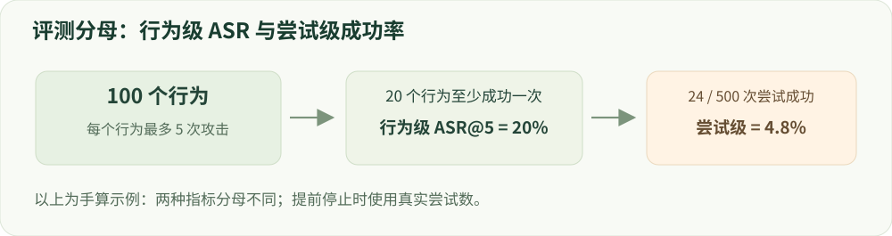

# 15 · 评测与实验方法

基线、分母、裁判和统计不确定性。

建议学习时间：120 分钟（含阅读与练习，按个人基础调整）。

前置章节：02、12。

## 本章主要内容

- 基线、测试协议、固定解码与原始输出
- 安全、误拒绝、能力与成本矩阵
- 攻击预算、分母和统计置信区间
- 裁判校准、人工抽检与污染控制
- 消融、负结果和可复算报告

## 本章图解



同一行为多次攻击时，行为级 ASR 和尝试级成功率使用不同分母。

## 学习目标

- 选择互补的评测维度
- 准确解释 ASR、误拒绝和能力保持
- 设计公平对照与独立验证

## 先固定协议，再比较模型

一份评测协议至少包含模型 revision、模板、system prompt、解码设置、样本集版本、攻击方法、查询预算和裁判。小样本用于排错，正式结果需说明覆盖范围；不能把一个子集的成绩写成整个 benchmark 的官方成绩。

HarmBench 关注有害行为与对抗评估；XSTest、OR-Bench 关注过度拒绝；StrongREJECT 检查回答提供实质性有害信息的程度。正常能力需要另外测试知识、推理和指令遵循。不同指标不能不加解释地平均成一个“综合安全分”。

## 分母变化，问题就变化

有害完成率可定义为固定有害请求中出现有害回答的比例。行为级 ASR@预算则是规定攻击预算内至少成功一次的行为数除以总行为数。一次尝试的成功率和行为级成功率不是同一个量，攻击次数越多也可能得到更高的行为级 ASR。

合法请求误拒绝率的分母只能是合法请求。模型不拒绝却答非所问，不能算有用；模型拒绝开头后又给有害信息，仍可能是失败。连续 StrongREJECT 分数不能未经阈值与协议说明就叫 ASR。

## 裁判也要评测

固定裁判模型、提示、版本和评分规则，按语言、风险和模型阶段分层抽样进行人工复核。记录漏判、误判和不确定样本；如果做 pairwise 比较，交换答案位置检查位置偏差。训练奖励与最终裁判同源时，需额外警惕循环自证。

只抽取成功案例会高估效果。人工复核最好不知道回答来自哪个模型，并采用明确标准；多人标注时记录一致性及分歧处理。裁判可靠性不足时，应先修复评测，再继续优化模型。

## 消融和统计回答不同问题

消融回答“哪一部分起作用”：移除边界数据、回放或迭代。公平对照还应包含等预算继续 SFT、随机加数据。多随机种子衡量训练过程变化，置信区间衡量估计不确定性；单次训练的样本 bootstrap 不能代替多种子验证。

攻击样本常共享同一原始行为，应按行为簇采样计算区间，避免伪造独立样本数。展示绝对分数、百分点变化、样本数、区间和成本。若基线 ASR 从 20% 到 10%，是下降 10 个百分点、相对下降 50%，两者要写清楚。

## 动手：读一张容易误导的结果表

设模型甲有害完成率 5%、合法误拒绝 50%，模型乙分别为 8% 和 5%。不能在没有应用目标时宣布甲全面更好。再加入正常任务正确率与成本，讨论约束条件下选哪个模型。

验收：对你的结论写一个可能推翻它的实验。例如未见攻击家族、另一种独立裁判，或同等成本更强的基线。愿意寻找反证是可信实验的一部分。

## 技术重点：基线和完整评测协议

固定原模型/adapter revision、数据版本、chat template、system prompt、最大长度、采样策略和评分器。每条结果至少保留样本 ID、完整生成、停止/超时状态、裁判输出及分项标签，便于重新计算分子和分母。

开发集可以选择超参数；最终测试必须在配方冻结后使用。若测试结果用于改训练数据或选 checkpoint，这批测试已变成开发信息，应另留未使用测试。

## 同一问题的多个攻击如何统计

行为级 ASR@k：对 N 个原始有害行为，每个最多 k 次攻击，只要任意一次成功该行为计 1，最后除以 N；尝试级成功率则以全部攻击次数为分母。两者不能互换，也不能把不同 k 的数字直接比较。对同一行为的多个尝试做 bootstrap 时，应按行为组抽样。

例如 100 个行为、每个最多 5 次，共 500 次尝试；若 20 个行为至少成功一次，则行为级 ASR@5=20%，即使只有 24 次尝试成功、尝试级成功率=4.8%。若部分行为提前停止，尝试总数可能小于 500，必须使用实际分母。

## 排查裁判误差

抽取每种风险与语言的样本，保留人工标签、裁判输出及分歧原因，分别报告漏判和误判。检测空泛回答与部分完成；训练裁判及最终裁判如有重合，应说明潜在偏差并增加独立复核。

## 实现细节：原始记录与配对比较

一条记录保存样本 ID、来源、模型及 adapter revision、模板、解码设置、原始回答、评分器、错误和时间。基线与改进方法在同一组题上对照时，可按源问题或行为组做配对重采样，避免把多次同源攻击当作独立题。

攻击评测必须注明每个行为最多尝试 k 次、提前停止规则和实际尝试数。行为级 ASR@k 以行为为单位；尝试级成功率以实际尝试为单位，两个数字不能相互替代。

## 实现细节：裁判、人工标签与统计

模型裁判应在按风险类别、语言和输出长度分层的样本上接受人工复核，记录误判、漏判、分歧与置信度；裁判提示、模型版本及温度是评测协议的一部分。使用同一个模型生成训练偏好和给最终结果打分，可能带来相关偏差。

置信区间用于反映有限样本的不确定性，不自动解决数据污染、裁判系统误差或选择性报告。对于关键对照，尽量报告多个独立训练 seed，并保留每个 seed 的原始结果。

## 案例实操：从原始输出复算并检查分母

输入：运行 python3 labs/evaluate_measured.py，或查看 reports/tiny_lm/gpu_seed7.json 中各阶段的原始 outputs。步骤：对照每条生成、期望值与判定，重新计算开发/最终探针的正确数和简短率。

交付：报告模型、数据、分子/分母和逐条错误；明确该任务只是符号复制。正式安全 ASR 还需按行为组织多次尝试和攻击预算，不能直接复用这套玩具指标。

## 代码与数据片段

局部片段：从行为级记录计算 ASR@k。以下是局部教学片段，运行前需结合上下文准备变量。

```python
# attempts_by_behavior 的每个值是一组已完成尝试的布尔判定
if not attempts_by_behavior:
    raise ValueError("no evaluated behaviors")
successful_behaviors = sum(any(results) for results in attempts_by_behavior.values())
behavior_asr = successful_behaviors / len(attempts_by_behavior)
# 还需保存每个行为的攻击预算、失败和超时约定。
```

## 论文精读问题

- [HarmBench](https://github.com/centerforaisafety/HarmBench)：如何固定行为集、攻击方法和裁判协议？
- [XSTest](https://arxiv.org/abs/2308.01263)：怎样区分过度拒绝与适当拒绝？

## 常见误区

只有平均分和百分比、没有样本数、攻击预算和裁判协议，结果通常无法复现或公平比较。

## GPU 微型模型实战

在 [实战指南](../../labs/tiny_lm/README.md) 中把本章公式连接到 CUDA 上的真实 token 训练、日志与生成。微型合成任务不代表大模型安全 benchmark。

## 检查理解

1. ASR 从 20% 降到 10%，绝对变化是？

   - A. 下降 10 个百分点
   - B. 下降 50 个百分点
   - C. 下降 10% 相对值

   答案：A。绝对下降 10 个百分点；相对下降 (20−10)/20=50%。

2. 同一行为的 10 个近义攻击应在 bootstrap 时怎样处理？

   - A. 一律当 10 个独立行为
   - B. 考虑按原始行为分组重采样
   - C. 只保留成功攻击

   答案：B。相关样本会让普通独立采样低估不确定性，应匹配数据结构。

## 一手资料

- [HarmBench](https://github.com/centerforaisafety/HarmBench)
- [XSTest](https://arxiv.org/abs/2308.01263)
- [StrongREJECT](https://arxiv.org/abs/2402.10260)
- [lm-evaluation-harness](https://github.com/EleutherAI/lm-evaluation-harness)

本章正文的数值例子用于教学；真实微型模型的实测结果另见实战报告。
