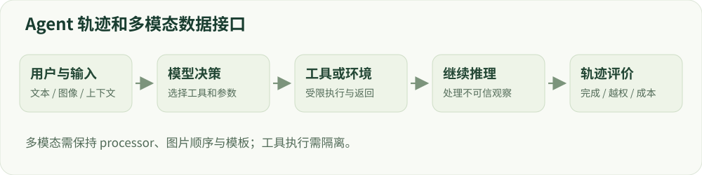

# 16 · 专项能力后训练

长上下文、多语言、Agent 与多模态。

建议学习时间：115 分钟（含阅读与练习，按个人基础调整）。

前置章节：03、10、12、15。

## 本章主要内容

- 领域适应与持续预训练
- 长上下文的长度分布及位置评测
- 多语言数据与语义复核
- 工具调用、Agent 轨迹和环境反馈
- 多模态 processor、模型组件及风险

## 本章图解



多模态输入、模型动作、工具反馈和轨迹评测的连接方式。

## 学习目标

- 理解不同任务的数据与反馈变化
- 识别轨迹级训练和评测要求
- 为一个专题写出可落地实验设计

## 领域适应与长上下文

领域适应可能使用持续预训练吸收领域文本，再通过 SFT 教任务格式。专业回答的正确性需要领域评价，不能只看风格像不像专家。数据来源、时效、版权和知识更新方式都应明确。

长上下文训练涉及长度分布、位置表示、注意力成本与远距离信息利用。能输入很多 token 不代表能稳定找到中间信息。评测应变化相关信息位置、干扰文本数量和任务类型，并检查截断是否改变答案条件。

## 多语言不只是机器翻译

不同语言的 tokenizer 效率、训练覆盖和文化表达不同。把英语安全测试直接翻译可能改变语义、自然程度或风险标签，需要母语/熟悉语境者复核。多语言混配还可能让高资源语言主导更新。

分别报告语言切片上的正常能力、安全与误拒绝，保留原语和翻译来源。跨语言攻击测试应说明攻击语言、目标回答语言和预算，不能把一个语言的结果当成所有语言的结论。

## 工具与 Agent 的学习对象是轨迹

工具调用数据不仅包含自然语言，还包含工具名称、结构化参数、工具返回和后续决策。SFT 可以教正确调用格式，环境反馈可评价任务是否完成。奖励需要考虑动作合法性、执行失败、重复调用和成本。

工具结果是不可信输入，模型不能因工具文本里出现命令就扩大授权。训练在沙盒中使用合成或可恢复环境；应用侧用最小权限、动作校验和审计限制真实影响。Agent 评测要看端到端任务成功与违规动作，不能只看最后一句话。

## 多模态增加了输入与对齐接口

视觉语言模型把图像编码与文本 token 结合，训练数据需要保持图像、问题和回答一致。哪些视觉模块、投影层或语言层参与训练，会影响显存、能力保持和数据需求。只修改文字模板却丢失图像占位符，会造成难以发现的错误。

安全评测也需考虑图文联合语义：文本本身合法不代表配图后的任务合法，图像分辨率和裁剪可能改变关键内容。需要模态对应的数据规范和攻击假设，文本 benchmark 无法直接证明视觉安全。

## 动手：选择一个延伸课题

从中文安全、长文档问答、沙盒工具调用或图文问答中选一个。写下输入输出格式、可训练组件、反馈来源、训练预算、正常能力与安全测试、最强基线。先完成小规模端到端闭环，再扩展模型规模。

验收：解释为什么你的专题不能直接照搬单轮文本 SFT 的数据和指标，并提出至少一个特有的失败案例。

## 技术重点：多模态 processor 与训练组件

视觉语言模型将图像和文本映射到模型可用的输入；processor 可能产生 input_ids、pixel_values、网格信息等。图像占位符、图文顺序、图像尺寸和训练标签必须一致。选择冻结视觉编码器、只训投影层还是训练语言层会改变成本与行为。

Qwen3.5-0.8B 模型卡提供多模态使用示例；本项目的 Qwen3 文本示例不自动支持它。模型卡所述最大上下文并不保证 12GB GPU 能以该长度训练。

## 从单轮文本转成工具轨迹

工具数据是一条包含多次模型消息、结构化调用、环境观测与最终回答的轨迹。SFT 除了自然语言，还要正确序列化工具 schema、调用参数与返回角色；训练时确认工具返回是否为监督目标，以及权限错误、调用超时和重试如何标注。

在线训练必须将工具限制在可恢复沙盒中，并把工具输出视为不可信上下文。评测分别看最终任务成功、参数合法率、越权动作、注入服从率与调用成本；礼貌的最终回答不能抹掉此前违规动作。

## 算例：工具轨迹的数据单元

一条工具任务可包含用户请求、助手发出的结构化调用、工具结果、助手的下一次调用和最终回答。工具结果是上下文而不一定是模型监督目标；数据应标注动作是否合法、参数是否有效和环境是否发生预期变化。

若工具返回文本要求忽视原权限，必须保持原授权边界。将允许的工具与虚构数据放在沙盒中，分别评测任务完成、无效调用、越权、注入服从及调用次数。

## 排查多模态输入

检查 processor 是否返回对应的图像张量、占位 token 和正确顺序；训练与推理均需遵循模型的 processor/template。调整分辨率、裁剪或帧采样后，原本的标签可能不再成立，需要重新检查。

## 实现细节：Agent 的动作监督

工具调用的 assistant 消息和工具返回需要不同角色，结构化参数应匹配 schema；是否对调用的 JSON token、自然语言说明或后续答案计 loss，取决于任务定义。工具返回可能含提示注入，应始终作为不可信观察处理。

环境反馈不只包含最终成功率，也包括无效参数、越权、重复调用、超时和成本。用沙盒虚构文件或服务建立可恢复测试，真实系统再增加权限、确认和审计层。

## 实现细节：多模态与长上下文成本

多模态样本需绑定图像、文本、占位符和 processor 的版本；训练时明确哪些视觉模块、投影层及语言层可训练。改变分辨率、裁剪或图片顺序可能改变标签适用性。

长上下文的 token 长度、答案位置、干扰内容和截断规则应分别变化；原生上下文窗口不等同于硬件可训练长度。对多语言任务，还要核对翻译是否改变了原意图与风险标签。

## 案例实操：构造一个沙盒工具轨迹

输入：设计一个只读的虚构 list_files 工具和合成目录，不连接真实服务。步骤：记录用户请求、工具 schema、模型调用、参数、工具返回和最终回答；单独注入一条要求改变原权限的工具返回作为反例。

交付：按任务完成、参数合法、越权和调用次数分别给出判定规则；说明工具返回只是上下文而非授权。该案例是实验设计，项目尚未声称实现完整 Agent 安全训练。

## 代码与数据片段

数据示意：工具调用是一条轨迹。以下是局部教学片段，运行前需结合上下文准备变量。

```python
trajectory = [
    {"role": "user", "content": "查询示例目录中的文件"},
    {"role": "assistant", "tool_call": {"name": "list_files", "arguments": {"path": "demo"}}},
    {"role": "tool", "content": "[\"a.txt\"]"},
    {"role": "assistant", "content": "示例目录包含 a.txt。"},
]
# 这是格式说明，不会执行工具。
```

## 论文精读问题

- [Qwen3.5-0.8B 模型卡（2026）](https://huggingface.co/Qwen/Qwen3.5-0.8B)：多模态 processor 与模型输入有哪些字段？
- [Olmo 3 技术报告（2025）](https://arxiv.org/abs/2512.13961)：开放模型如何报告训练生命周期与能力？

## 常见误区

专项能力的任务成功率不能替代安全指标；输出文字安全也不保证工具动作安全。

## 检查理解

1. Agent 的最终回答很礼貌，能证明执行过程安全吗？

   - A. 能
   - B. 不能，需检查工具动作与权限
   - C. 只要回答足够短就能

   答案：B。违规动作可能已经发生，必须评测轨迹和环境中的真实操作。

2. 英语测试直接翻成中文后，应如何报告？

   - A. 冒用原 benchmark 的同等官方分数
   - B. 标为翻译扩展集并复核语义与标签
   - C. 无需记录语言

   答案：B。翻译可能改变难度和语境，需要单独报告协议和复核过程。

## 一手资料

- [Transformers · Chat templates](https://huggingface.co/docs/transformers/chat_templating)
- [TRL · GRPO Trainer](https://huggingface.co/docs/trl/grpo_trainer)
- [Tülu 3 开放后训练流程](https://arxiv.org/abs/2411.15124)
- [Qwen3.5-0.8B 模型卡（2026）](https://huggingface.co/Qwen/Qwen3.5-0.8B)
- [Qwen3 Technical Report（2025）](https://arxiv.org/abs/2505.09388)
- [Olmo 3 技术报告（2025）](https://arxiv.org/abs/2512.13961)

本章正文的数值例子用于教学；真实微型模型的实测结果另见实战报告。
